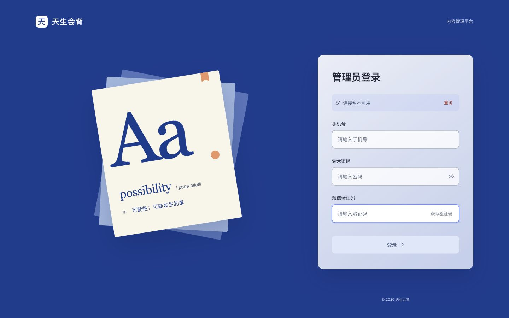
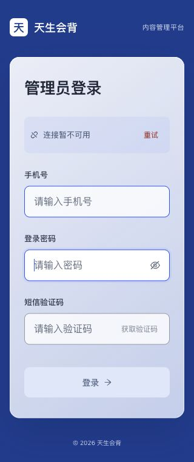

# Admin 登录页

采用全屏深蓝背景、左侧纸页字形与右侧磨砂登录卡片。移动端隐藏装饰区，保留登录表单；输入字号为 16px，验证码和重试按钮点击高度为 44px。保留常规占位提示，移除欢迎语、口号及重复说明。

登录页的连接异常提示移到卡片内，红色「重试」调用原会话恢复逻辑；会话结果未确认时保留「重新登录」入口。恢复成功后移除提示，不重挂表单或丢失输入。后台其他页面保留原有全局提示。

登录接口、手机号/密码/验证码三要素、发码冷却、请求在途锁、会话落地、权限不兼容提示、首次改密与安全回跳均保持不变。磨砂不受支持或用户偏好减少透明度时，使用实色背景。

## 验证

- 44 项组件及会话恢复测试通过，覆盖登录、锁定、改密、回跳、恢复、输入保留及 `/login/`、`/LOGIN` 路由变体。
- admin 构建通过；类型检查由正常 pre-push hook 执行。
- Codex 内置浏览器检查桌面与手机，320px 宽度无横向溢出，Tab 顺序及密码显隐正常。
- 按磨砂表面最深色计算，占位文字、连接提示和红色重试文字对比度分别不低于 4.77、5.03、4.74。
- 浏览器验收使用本地实际 admin 页面，未发送真实短信或登录真实账号。原本地会话刷新存在后端 500，连接异常提示截图来自该状态；该后端问题不在本次修改范围内。

## 桌面与手机

