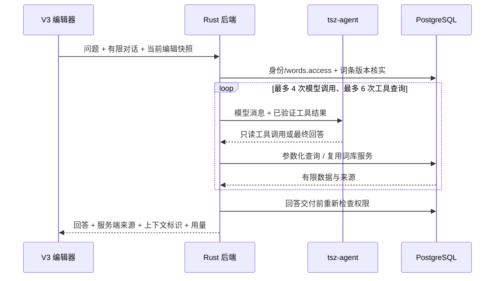

# 词库只读 Agent

## 目标与范围

在后台 V3 词条编辑器提供小精灵入口与侧边对话。结合当前未保存内容、智能词库和内置词典，回答填写问题、比较释义并提供例句建议。结果供人工核查；模型不直接修改数据库。管理员可预览采纳候选到本地草稿，再通过现有流程保存，不自动发布。

本轮完成本地实现和验证；不提交、推送、合并或部署。无自动保存/发布、浏览网页、任意 SQL、全库语义查重、长期记忆或向量数据库。

## 基线与依赖

- 前端：`/Users/darwish/.codex/worktrees/edda/tsz`，`codex/lexicon-readonly-agent`，基线 `bb657959`。
- Rust：`/Users/darwish/.codex/worktrees/lexicon-readonly-agent-backend/tsz-rust`，同名分支，从 `origin/main` 创建。
- Agent：`/Users/darwish/.codex/worktrees/lexicon-readonly-agent-runtime/tsz-agent`，同名分支，基线 `a33dc78`。应用的托管 worktree 工具不接受此仓库作为项目来源，因此使用原生 Git 创建隔离 worktree。
- 已有：后台鉴权及权限、V3 草稿读取与分页检索、内置词典内容读取、编辑器本地草稿、完成情况、字段定位。
- 可复用：现有 Agent 服务身份与 DeepSeek 配置、Python/OpenAI-compatible 客户端；命题工作流和命题模型选择保持独立。
- 新增：词库助手契约、只读工具执行、受限对话循环、规则资料、当前编辑内容投影（展开共享词形，去除内部节点标识、音频和审计字段）、侧边面板及风险测试。
- 环境依赖：前端依赖安装、Agent uv 环境、Rust 构建、隔离 PostgreSQL/Redis 和真实模型配置；实际核实后记录，不沿用历史验收结果。

## 架构

Rust 持有本轮工具执行权，Agent 负责模型交互及选择工具。这样无需新增跨服务用户委托令牌、回调端点、数据库表或迁移。对话仅在页面内存中保存，切换词条清空；关闭面板保留，离开编辑器后释放。现有命题 run/账本与助手对话结构不同，不把问答伪装成命题任务；本轮返回并记录脱敏的实际调用/用量指标，不虚构费用。

### 外部契约

- `POST /api/v1/admin/lexicon/assistant/stream`：编辑器默认使用的真实流式问答，`application/x-ndjson` 逐行输出 `status`、`delta`、`reset`、`complete` 或 `failed`。查询状态即刻展示，模型生成时按实际增量展示，最终事件携带来源和用量；中断不得被当作完整回答。
- `POST /api/v1/admin/lexicon/assistant`：保留非流式接口用于兼容及工具链验证，受 `words.access` 控制。输入 `entry_id`、`base_revision`、`context_id`、`step`、`local_content`、`context_truncated`、`question`、有限 `history`。本地内容始终标为未保存的用户输入，不能当成服务端事实。
- 响应包含相同 `entry_id/context_id`、回答、只读来源、调用及 token 用量、`requires_human_review=true`。来源由工具执行器生成，模型不能捏造可点击链接。
- `GET /api/v1/admin/lexicon/assistant/capability`：查询助手服务是否配置；旧后端 404 或未配置时编辑不受影响，面板明确显示暂不可用。
- Agent 内部 `POST /v1/lexicon-assistant/step/stream`：转发提供方真实文本增量和已校验的最终工具/用量回执；保留 `POST /v1/lexicon-assistant/step` 非流式接口。使用既有服务 Bearer 身份；一次模型调用，工具名称/参数与响应均严格校验。不会接收用户令牌或数据库连接。
- 不修改已有严格响应，新增路径保持旧前端兼容；顺序为 Agent → Rust → 前端，新前端访问旧后端明确提示能力未就绪。

### 工具与资料

- `search_lexicon(q)`：复用分页查询，限制结果数量，返回词条 ID、词面、状态和释义摘要；说明是有限关键词检索，不能称为全库查重。
- `read_lexicon(entry_id)`：复用 V3 读取服务，投影内容字段并限制大小，明确草稿版本；移除管理员身份、对象地址和运维字段。
- `lookup_dictionary(q)`：只读查询当前 active 数据集的词头、词性、地区、senses/forms/sounds，返回来源与版本及截断标记；无内容明确返回缺失，不生成假词典记录。
- `read_filling_rules()`：读取随代码维护的规则说明及当前词性配置。业务校验仍是发布权威，不将 AI 判断作为发布许可。

### 边界

- 本地快照和词典/词库文字都视为不可信资料，不能提升为系统指令；工具只允许上述枚举，参数拒绝未知字段。
- 问题、历史、快照、模型输入/输出、工具结果与工具次数均限额；Rust 总超时、Agent 单次超时和管理员级并发/频率限制。模型调用不自动重试，避免未知结果重复计费。
- 模型密钥仅由 Agent 既有配置读取；本轮固定现有 DeepSeek 提供方，不修改命题的全局模型选择，不自动切换其他供应商。
- 身份在查询及交付前重新核查，权限撤销后不继续查询或交付。版本变化提示重提问题；回答绑定请求快照，前端忽略已切换词条/已取消的迟到结果。
- 用户停止保留已收到的文字并标为未完成，不进入后续对话历史；浏览器断开会取消本轮后端等待、关闭上游读取并释放并发预约。已发出的上游请求仍可能已计费。流式每次交付增量前重新核实身份/权限和词条版本，最后交付来源前再检查。
- 服务端来源与模型建议分开展示；不把库内草稿、内置词典与模型推断混为权威事实。

## 实施与验收

1. Rust/Agent 契约与只读工具 → 验证权限、未知工具、真实数据库查询及调用限额。
2. 对话与 V3 编辑器上下文 → 验证未保存文本进入请求、旧回答隔离、取消/失败保留输入、来源入口。
3. OpenAPI 同步与三端检查 → 使用所选后端导出快照，检查严格 wire 类型与新增路径兼容。
4. 真实联调 → 专属本地 PostgreSQL/Redis、测试账号和词条/词典 fixture；真实页面提问、工具检索和模型回答分别记录。无真实模型时仅称服务/工具联调，不冒称真实 Agent 验收。

验收需证明：两类数据实际被查询；无词典数据时不编造；未保存内容参与回答；模型不能写业务数据；权限撤销拒绝交付；切换词条不串话；超时/预算耗尽可恢复；现有编辑保存流程不受影响。测试数据按精确 fixture 归属清理，无 OSS 创建。

## 只读阶段验收记录

实现验收时三仓均为未提交改动，分支均为 `codex/lexicon-readonly-agent`。下列结果对应当时的代码与隔离环境；后续交付状态见文末。

- 前端 API 客户端 36 文件 / 664 项通过；助手、V3 布局和页面回归 3 文件 / 100 项通过；全仓 7 项类型检查、受影响 ESLint、格式和后台生产构建通过。
- Rust 助手定向 handler 4 项通过，覆盖两类数据、无业务写入、未知写工具、版本失效、调用预算、权限撤销和上游尚未结束时的真实增量；工具/投影单元 2 项通过。最终代码 fmt、Clippy 全 target / 全 feature 通过。
- Agent 隔离数据库完整测试 212 项通过、4 项可选实机 runtime 测试跳过；最终领域提示调整后定向 8 项通过。Ruff、格式、mypy、契约导出漂移及 wheel/sdist 构建通过。
- 内置浏览器通过真实登录和同源代理，实际调用 DeepSeek 查询智能词库、内置词典及填写规则；截图捕获了完成前出现的真实文字增量。助手读到仅应用在本地、未保存的 `/bæŋk/`；实际停止后保留已收到文字，切换 river 后对话和输入为空。
- 数据使用专属本地合成 fixture，不代表已经检验部署环境的真实全量词典覆盖。独立数据库指纹复核确认两条 canonical 词条及编辑投影完全未变，无音频或 OSS 创建。
- 桌面 1280×900、移动 390×844 验收通过；移动面板宽度曾超出屏幕，已改为限制在视口内，复查页面与面板均为 390px。
- 初次模型回答曾混入内部字段和不正确的共用词形建议；已展开共享内容、移除内部节点标识，并补充词形、发音与界面转换按钮的领域指令。仍保留人工核查边界，不把模型回答作为业务校验。
- 临时账号、会话、词条、词典 fixture、SQLx 测试库和 Agent 测试数据随专属 PostgreSQL/Redis 容器彻底清理；站点 local/session storage、IndexedDB、缓存与 service worker 均为零。本任务进程、临时页面和私有凭据/原始文件已清理，原有提供方配置及既有运行容器保留。

详细证据见 [检查结果](acceptance/checks.json)、[清理回执](acceptance/cleanup.json)、[桌面来源](acceptance/desktop.png)、[真实流式输出](acceptance/streaming.png)、[停止保留内容](acceptance/stopped.png) 和 [移动端](acceptance/mobile.png)。

## AI 词性与发音候选导入（追加范围）

用户已确认：由小精灵生成结构化候选，管理员预览勾选后导入当前草稿。问答工具仍只读；模型不直接执行编辑。

- 新增独立生成接口，复用 DeepSeek、当前词条权限/版本和请求预算。候选只使用当前词性目录与允许词形编码，单次生成，不解析聊天文字，不自动换模型或隐式重试。
- 首版每个候选词性返回原形及必要词形，每个词形有英/美拼写与一组字典音标。缺少把握的音标留空并提示核查；实际发音及 Azure IPA 由现有转换器推导，不让模型生成平台专用音标或音频。
- 预览展示词性、词形、英美音标、转换结果和冲突说明。只补空缺，保留非空人工内容、引用 ID 和共享关系。既有多变化组、英美规则冲突及多处共用内容无法安全归属时明确跳过。采纳后按人工确认内容记录，不能冒充词典来源。
- 生成绑定 entry_id/base_revision/context_id 与完整本地词形快照；词条、词形或词性目录在预览期间变化时禁止旧结果导入。取消、失败和重新生成均保留当前编辑。
- 回填通过现有 shared_v1 建模和 Wizard 状态入口，联动词义骨架与完成情况；仍需管理员保存。导入按钮受真实编辑权限与只读/冲突状态约束。
- 验证：模型/目录契约和非法输出；新增/补空/共享引用与人工内容保留；过期和只读拒绝；真实模型 → 预览 → 本地导入 → 人工保存 → 重新读取。验证使用新建隔离 fixture，不改当前本地体验环境中的用户内容。

实现、定向检查和真实联调已完成，并已更新保留中的本地体验环境 `http://127.0.0.1:62487`。以下保留本轮实现验收证据。

- API 客户端 666 项通过；导入计划/预览弹窗 8 项通过，覆盖空原形回退、区分标注、英美部分空缺、强调读法、已有音频、共享绑定、只读、旧快照和取消迟到响应；原助手/布局/Wizard 的 100 项回归结果复用。全仓 7 项类型检查、受影响 ESLint/格式及最新 Admin 生产构建通过。
- Rust 助手 handler 6 项通过，新增候选权限、目录/版本、非法模型字段和不写入验证；Clippy 全 target / 全 feature、fmt 通过。无迁移，无新增集成测试 target。
- Agent 完整隔离测试 219 项通过，4 项可选 runtime 测试跳过；最终提示调整后候选定向 7 项通过。Ruff、格式、mypy、原生契约导出及构建通过。
- 使用真实 DeepSeek、真实 API、生产静态预览与内置浏览器。`center` 一次导入名词/动词共 7 个词形，导入后数据库仍未变化；明确保存后独立 GET/数据库重读确认持久化。`colour / color` 的英美拼写、音标与实际发音分别保存，状态仍是草稿，无音频或 OSS 创建。
- 转换器拒绝不明确的可选音素标记时保留空缺并展示核查提示。已补充生成规则以明确地区拼写和确定读音；一次生成返回 503，未采纳候选或改动草稿，重试保持显式操作。AI 建议仍需人工核查。
- 长候选预览使用有界滚动区域；桌面 1280×900 导入按钮底部为 838px，移动 390×844 页宽为 390px、弹窗 358px、操作区底部为 802px，均可见。
- 临时验证环境与用户体验环境使用不同 PostgreSQL/Redis 和 cookie origin；专属 4 条词条、账号/会话、测试数据库、进程、站点存储及原始私有文件已清理。用户的 62487 体验环境、已有账号和编辑内容继续保留。

生成使用提供方 JSON 模式并做目录与业务二次校验，格式能力参考 [DeepSeek JSON 输出文档](https://api-docs.deepseek.com/guides/json_mode/)。检查和清理证据见 [候选检查](acceptance/candidates/checks.json)、[候选清理](acceptance/candidates/cleanup.json)、[预览](acceptance/candidates/preview.png) 与 [移动端](acceptance/candidates/mobile.png)。

## 本地版本保存

2026-10-31 用户授权保存当前版本：三仓分别在 `codex/lexicon-readonly-agent` 创建本地 conventional commit，提交范围为本任务代码、契约、测试及脱敏验收记录。保持原生 hooks；复用同输入下已经通过的检查，后端 SQLx hook 使用专属校验数据库。此次范围不含 push、PR、合并或部署，本地体验环境继续保留。精确提交与审查结果在本次对话交付。

提交后独立初审确认 1 项 P2：清空带标注字段后，候选补空只改纯文本而未同步 rich/speech 文本，导致编辑显示为空并被后端一致性校验拒绝。初次修复同步了已有空富文本；增量复查进一步确认同根因的 UK/US IPA/UPS 合成试听文本也必须随拼写同步。因此改为直接复用现有 `applyVariantSpelling` 统一处理所有拼写关联文本与音频失效规则，字典/实际发音富文本继续复用 `editRichText`。同一回归覆盖旧 V1/V2 富文本和四条合成试听路径，在旧实现上分别复现失败；最新导入计划、预览与原拼写操作共 65 项通过，Admin 类型检查与生产构建通过。配置、节点身份和非空人工内容保持原逻辑。

审查：已完成 2 轮（初审及增量复查）；确认缺陷 1（同根因，已统一修复）；证据排除误报 0；关联回归/回退：未知。修复提交的最终增量复查结果与 SHA 在本次对话交付。

提交 hooks 的 SQLx 刷新最终未产生额外缓存差异，SQLx/Clippy 正常通过；专属提交校验库及私有配置已清理，保留中的用户体验数据库未被使用。

## PR 交付

2026-11-01 用户授权推送并创建三仓面向 `main` 的配套 PR。任务分支合入当日核实的前端主线 `dc8f3afb` 与 Rust 主线 `96eabd7b`；保留原任务提交，不改写历史。OpenAPI 与前端生成快照冲突通过两仓原生生成器解决，业务源码自动合并后做定向检查与精确提交增量复查。Agent 功能提交不变。

Agent 配套 PR：[tsz-agent #14](https://github.com/LonelyFellas/tsz-agent/pull/14)。前端/Rust 的精确提交、PR 和当前 CI 在本次对话及各 PR 交付。发布准备顺序仍为 Agent → Rust → Admin；新增能力缺失时明确不可用，词条编辑链路保留。此功能没有引入新数据格式或迁移，回填仍走原有 V3 草稿保存；已部署版本与实际回退组合尚未在本次发布阶段验证，不能据此执行部署。
