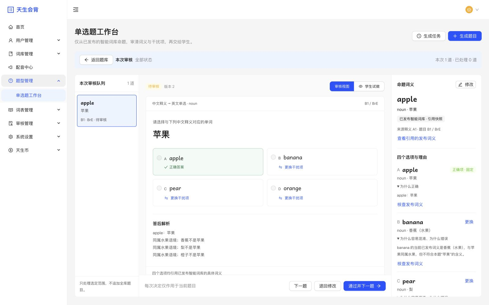
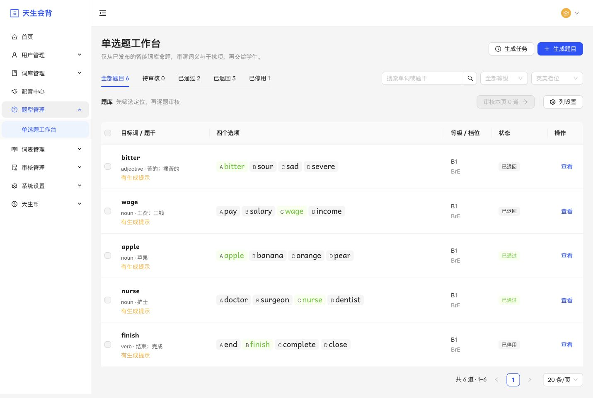
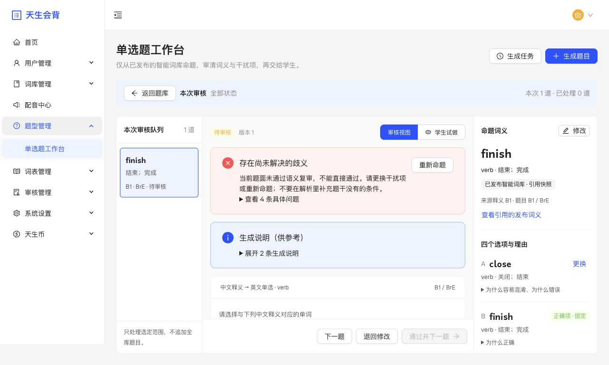
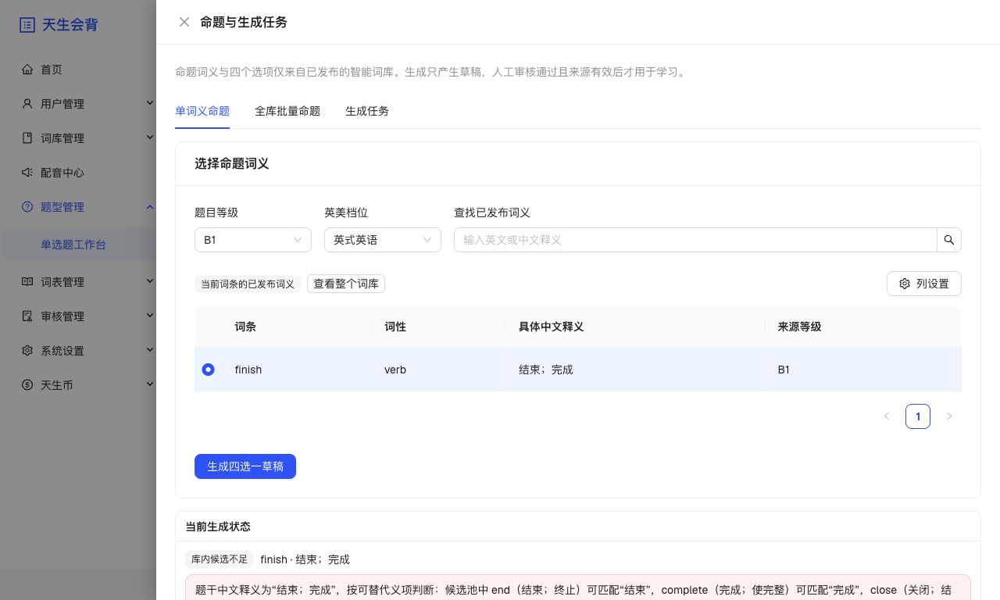

# 单选题工作台落地

## 目标与范围

将会话已确认的 system-v3 原型落为真实后台：独立“题型管理”菜单、可检索分页题库、当前页/已选题目的固定审核队列、并置题面与发布来源、库内更换干扰项、原稿对照及学生试做。保留生成、取消、批次、审核、归属和幂等规则，词库独立发布。

命题对象与四个选项仅来自当前有效发布、可教学、非上下文依赖的智能词库。沿用后端同词性、不同词条、档位/等级和有效拼写校验。合法候选内优先易混淆，不能为补足数量引入库外词或第二个正确答案。

## 当前基线与依赖

- 前端：`/Users/darwish/.codex/worktrees/029c/tsz`，`codex/question-bank-workbench`，基线 `8f773676`。
- 后端：`/Users/darwish/.codex/worktrees/question-bank-workbench-backend/tsz-rust`，同名分支，基线 `0d597e3`。
- 已在主线/可复用：词义来源、单题及全库批次生成、取消、审核、原稿、权限与 C 端四选一；不重新实现 Agent 或学习判分。
- 小改动：菜单分组、固定审核范围、现有生成/批次入口接回审核、编辑与试做呈现。
- 新工作：兼容的轻量题库检索和来源检查读取；数据库分页的已发布候选检索及替换过滤。旧严格响应保持不变。
- 已完成关键路径：后端读契约与查询 → OpenAPI/types/client → Admin 工作台 → 定向验证及隔离真实联调。

## 可观察验收

- 搜索、状态、等级和档位筛选应用于服务端完整结果，而非已加载页。候选只解析当前页的发布内容，覆盖多词义、基础词形、form group 绑定及权限。
- 进入审核后范围固定，审核改变状态不跳题；返回保留筛选和页码。新任务不插入已有队列。
- 审题核查题目引用的发布候选与当前来源状态，不把编辑预览中的草稿当作发布来源。来源变化阻止审核，正确项变化须重新命题。
- 库内替换过滤不同词条、重叠拼写、词性/等级/档位及已知同释义；选择后才进入编辑，换项清空旧理由。失败/版本冲突保留本地内容；停用/退回后的编辑回到待审核。
- 学生试做答前隐藏正确项、来源与目标词队列，答后显示解析；不调用学习提交、不写学习或记忆记录。
- 保留 words.access/edit/edit_others/publish 与资源归属校验，业务规则不依赖前端禁用按钮。
- 旧接口响应与客户端严格 schema 保持兼容。新增端点需要后端先可用；新前端遇到旧后端应明确功能未就绪。
- 浏览器通过真实本地 Admin → 本任务 API → 专属 PostgreSQL/Redis 验证读取、保存和重新读取；模型未改，生成调度若使用替身须独立标明。清理本任务 fixture、服务及临时目录。

## 当前阶段与交付边界

实现、真实页面与规模验收已完成，隔离测试资源已清理，终点为本地代码和验证结果。提交、push、PR、合并及部署不在本轮范围，均未执行。原型及设计细节保留在本会话的 `single-choice-workbench/system-v3/`，跨仓只更新本主记录。

## 交互和查询实现

- 题库用服务端搜索、状态/等级/档位筛选及 20/50 条分页；显式选择“审核本页”或“审核已选”后固定题目 ID，行内审核只进入当前题。返回题库保留筛选和页码。
- 审核并置题面与引用的发布词义；正确项锁定，干扰项从分页候选中替换。重开题目重新核查来源；请求失败或版本冲突保留输入，来源核查暂时失败时保留草稿并暂停审核。
- 保留生成抽屉、批次取消、幂等及未知结果的恢复流程。生成抽屉重新打开不丢失未确认请求，审核期间的新题不插入固定队列。
- 新增 `GET /admin/question-bank/questions/workbench`、`GET /admin/question-bank/questions/{id}/inspection`、`POST /admin/question-bank/candidate-search`，均位于 `/api/v1` 下。原接口及严格响应不变。
- 候选索引按当前发布快照投影，支持 inline 和 `shared_v1` 词形；发布写入/切换在同一事务维护索引。分页后再次调用已有来源解析和冻结标识校验，不直接把索引视为权威来源。
- 5 万数据暴露了原动态 JSON 候选查询超时，已改为派生索引和当前页解析。新增 `entry_id` 外键支持索引，避免批量删除反复扫描。一次性迁移回填允许 5 分钟；API 原有 10 秒超时未放宽。
- 易混淆候选仍由现有 Agent 判断，查询仅提供拼写和中文释义字面相似度排序信号。本轮没有将该信号宣称为语义质量评分，也未放宽唯一答案等合法性约束。

## 第一轮实现验证结果

- 后台题库、审核和菜单相关测试 **47 项 / 3 文件**通过；覆盖固定队列、重新核查、保存失败/迟到响应、权限、失效来源、替换理由及实际焦点。全仓类型检查 **7 项任务**、受影响 ESLint、后台生产构建和格式检查通过。
- API 客户端 **650 项 / 33 文件**通过。OpenAPI 来源为本任务后端，SHA256 `5bb70d54aeb4c71ca29b7cd0f7cf213ca84fb4586de7b1f5239c891da0e61155`；比较的 **15 个旧响应 schema、4 个旧查询参数**完全不变，见 [契约兼容回执](acceptance/compatibility.json)。
- 后端扩大回归 **219 项**通过：词库 176、生命周期 12、存储格式 13、题库 18；最终外键索引加入后，题库 18、生命周期 12、硬删除 1 再次通过。授权路由核对 2 项通过，最终代码 fmt 和 `Clippy --all-targets --all-features -- -D warnings` 通过。
- 原有 admin 完整测试曾因命令参数分隔方式意外运行：156 文件通过、题库文件旧入口断言失败（含当时未修复的旧组件引用）；相关测试现已迁移并定向通过，不将那次全量称为通过。后续不重复无变化范围。
- 实际浏览器已完成真实 2FA 登录、第二页选择两题、库内替换、保存、刷新独立读取、试做及审核。单题生成由明确本地 Agent 替身返回，经真实后端导入并进入持久化单题审核队列；不作为真实模型质量验收。
- 已切换一个专属 fixture 的发布版本，真实页面读取到干扰项失效并阻止审核；重新引用新发布词义、补理由、保存后恢复可审核。未修改正确项绑定。
- 桌面 1600×1000、1280×800 和移动 390×844 验收通过，移动试做无横向溢出；浏览器错误日志为空。已核查 `shared_v1` 发布来源。C 端实现未改，本轮未重跑 C 端端到端链路。详见 [验证回执](acceptance/checks.json)。

## 规模采样与清理

隔离数据库包含 50,006 词条、50,027 题目、200,024 个发布候选组合。真实 HTTP 单次本地采样如下，不能用作吞吐或生产 SLA 承诺，详见 [测量数据](acceptance/performance.json)。

| 操作                         |             耗时 |
| ---------------------------- | ---------------: |
| 题库第 1 页 / 第 1000 页     |   63.5 / 62.0 ms |
| 题库带条件搜索               |       1,223.0 ms |
| 发布候选第 1 页 / 第 1000 页 | 148.7 / 211.7 ms |
| 发布候选关键词搜索           |          41.1 ms |

5 万规模 fixture 按登记 ID 清除后，独立核对其题目、生成记录、词条、发布及索引均为零，保留的 6 词条、27 题目未受影响。首次清理因缺失外键支持索引超时，事务已完整回滚；补齐索引后 17.38 秒完成。见 [规模清理回执](acceptance/performance-cleanup.json) 和 [诊断记录](acceptance/cleanup-scan-diagnostic.json)。

验收 run 为 `qbw-20261029-5a39b215`，使用专属 PostgreSQL/Redis、端口和测试账号，Admin 三个 API mock 开关均为 false。验收结束正常退出账号，专属站点本地存储、会话存储、缓存、IndexedDB 和 Service Worker 计数均为零；随后清除专属容器和存储卷，覆盖所有剩余 fixture、账号、会话及 SQLx 临时数据库。专属服务和 Agent 替身已停止，临时页面、辅助程序、原始日志、随机凭据及私有运行目录已删除。无 OSS 创建，其他运行容器未受影响，见 [最终清理回执](acceptance/cleanup.json)。

## 配套发布与回退边界

后端先完成迁移并提供三个新接口，再发布前端。旧前端继续使用未变的原接口；新前端依赖新接口，不能先于后端发布。派生索引 down 迁移只移除索引投影与维护函数，不删除题目、发布快照或学习事实。后端回退须同步核对其 migrator 对新 migration 的识别，不能假定旧 binary 可直接启动。本轮未执行发布或部署回退演练。

## 真实 Agent 生成与审核复验（2026-10-29）

**结论：真实生成、人工审核和反馈再命题的链路可用，但当前不能自动保证语义唯一答案。** 来源合法、四选一结构和语义正确是不同的验收项；有限样例通过也不构成全库质量保证。

### 环境与范围

- 复用前后端本任务 checkout，业务代码未修改。Agent 使用最新主线 `fad44e9ab166845522e1299c8bfae2bca224f5bc` 的独立本地源码快照，经原生 Alembic 迁移、FastAPI 和 worker 运行，未替换模型适配器或响应。
- 使用现有配置的真实 `deepseek-flash`；生成和语义复审是同一模型的两次独立调用，不是不同供应商交叉验证。共 **6 次生成、12 次模型请求**，没有自动任务重试。
- 专属数据库中构造并发布 **51 个代表性测试词条**，包含水果、医疗职业、薪酬、近义动词及多义形容词。全部选项经真实 Rust 授权来源接口取得，6 题各 4 项及目标的当前发布核查均通过。词条来自隔离 fixture，**不是生产全库抽样**；统一 B1 标签仅用于本轮候选范围，不作为真实 CEFR 难度评价。
- Admin `qbw-real-20261029.localhost:30481` → Rust `127.0.0.1:18481/api/v1` → Agent `127.0.0.1:18482`，使用专属 PostgreSQL/Redis。Admin API mock 全部关闭。内置浏览器正常完成密码与验证码登录；验证码使用本地 Mock sender，没有真实短信。
- 模型账本观测输入 **15,928 tokens**、输出 **2,977 tokens**。按系统记录单价估算 **¥0.04262624**，12 次均可计价；这不是供应商账单，原始 `usage.cost` 仍为 `null`。见 [用量回执](acceptance/real-agent/model-usage.json)。

### 实际样例与质量判断

| 样例                         | 生成的干扰项                 | 模型复审   | 本轮审查与最终状态                                                                                    |
| ---------------------------- | ---------------------------- | ---------- | ----------------------------------------------------------------------------------------------------- |
| apple · 苹果                 | banana / orange / pear       | 无明显问题 | 同类词有基础干扰价值，未发现第二答案；通过。不能据此声称对熟练学习者仍有高区分度。                    |
| nurse · 护士，首次           | caregiver / doctor / surgeon | 需要修改   | caregiver 与照护角色边界被提示有风险；保守退回，不将模型警报本身当作两词完全同义的事实。              |
| bitter · 苦的；痛苦的        | sour / sad / severe          | 无明显问题 | severe 干扰偏弱，sad 与“痛苦的”存在需辨析的情绪边界；保守退回。模型“无明显问题”不能代替人工质量判断。 |
| finish · 结束；完成          | end / complete / close       | 需要修改   | 多个选项能匹配原题干的含义，不能当作合格单选；负向批准测试后立即停用。                                |
| wage · 工资；工钱            | pay / salary / income        | 需要修改   | pay、salary 有可辩护的正确性，原题干没有结算周期限定；退回。                                          |
| nurse · 护士，读取反馈后重生 | doctor / surgeon / dentist   | 无明显问题 | 避开 caregiver，保持同一医疗职业语义场且职业所指不同；试做后通过。                                    |

以上是小样本的逐题审查结论，不计算或外推“准确率”。生成原文、各项理由、复审问题及最终状态见 [六题记录](acceptance/real-agent/samples.json)。

`finish` 生成者把“结束；完成”错误理解成必须同时覆盖全部中文含义，进而用“只覆盖其中一项”判错；`wage` 的理由又加入题干没有的按小时/日/周结算条件，甚至承认 `pay` 可构成另一合理答案却仍将其选入。独立复审均指出风险，说明当前复审有价值，但生成后没有自动更换这些选项。

词典交叉核查也支持这两处风险：Cambridge 将 [finish 的核心义](https://dictionary.cambridge.org/us/dictionary/english/finish)解释为完成或结束活动；Collins 的 [pay 释义](https://www.collinsdictionary.com/english-language-learning/pay)覆盖雇主支付的工资或薪金。基于这些释义，宽泛中文题干不足以排除对应近义选项；不能把解析里补写的条件当作原题干条件。

### 审核闭环与负向验证

浏览器实际退回首次 `nurse`，填写具体歧义意见；后端将事件送达真实 Agent。再次从页面发起命题，Agent checkpoint 中存在 **1 条**该人工反馈，新草稿的说明和选项均反映了意见。页面完成试做、批准，并重新加载核对状态。所有 **7 条**审核/停用事件均已送达 Agent；试做后 `users`、`learning_tasks`、`learning_runs`、`learning_answers` 均为零。

服务端负向请求实际拦截了重复词条/拼写（400）、伪造非当前发布来源（409）、移除正确目标（400）。但是直接批准原始 `finish` 歧义题返回 **200 / approved**；随即停用返回 **200 / disabled**，再次 GET 确认为停用。这只发生在没有学习用户的专属库中，不触碰共享或生产题目。见 [负向回执](acceptance/real-agent/negative-checks.json)。

原因与现有代码一致：后端审核检查来源、选项、目标和完全相同的已录入释义；**不验证近义/部分义项重叠，也不以模型的 `needs_revision` 阻止人工批准**。模型复审问题被投影为待核查提示，人仍能直接通过。当前页面还把一般生成说明与实质歧义混在同一提示中，需要在后续交互优化中区分。

后续建议优先修复“为了接近而选入合理答案”的策略：不得把并列中文含义当作必须全部覆盖的判错依据；语义复审发现问题时先在合法发布候选内有限次数重选，再复审；仍无合适项时明确报告候选不足。审核应明确呈现未解决风险及处理依据，不能用“来源有效”或模型“无明显问题”代替语义结论。这些是本轮实测后的建议，**尚未修改生成策略、契约或审核规则**，也不增加单词发布绑定题目的要求。

### 收尾与边界

本轮只增加验收记录和脱敏证据，不修改业务实现，不重新执行无变更范围的整套代码测试。最终格式检查及两仓 `git diff --check` 作为文档收尾检查；原实现的有效检查沿用上轮结果。

专属 run `qbw-real-20261029-0e56894a` 的测试账号、会话、51 个发布词条、6 道题、7 条反馈、Agent 任务与模型账本随专属数据库卷彻底清除；本地服务、worker、临时浏览器存储、临时清理页、原始日志、源码快照及复制的凭据配置已清理。原有 DeepSeek 配置与其他运行容器保留。没有 OSS 创建，没有提交、push、PR 或部署。详见 [环境与来源回执](acceptance/real-agent/summary.json)、[清理回执](acceptance/real-agent/cleanup.json)。

## 语义重选闭环实施与复验（2026-10-29）

本节记录用户随后授权实施的闭环，取代上一节“尚未修改策略”的阶段状态。三仓实现和真实复验均已完成，交付终点仍为本地代码与验收结果；未提交、push、开 PR、合并或部署。

### 实现与边界

- Agent 在 `/Users/darwish/.codex/worktrees/question-bank-semantic-loop-agent/tsz-agent`，分支 `codex/question-bank-semantic-loop`，从最新主线 `76b5f6c` 创建；前后端继续复用本任务 checkout。现有候选检索、来源核查、人工反馈、预算账本及租约能力直接复用。
- 首次命题 → 独立语义复审；发现问题或生成者要求修改原题干时，把具体问题及原干扰项送回命题阶段，在有效发布候选内**最多重选一次**，再复审。至多复用一次既有候选补充检索，不扩大词性、等级、英美档位或发布范围。
- 仅修改理由、调换顺序或重复原来三个词条不算重选成功；仍无法排除问题、明确缺少合适候选，或剩余预算无法完成复审时返回 `insufficient_candidates`，保留具体原因，**不创建题目**。生成、复审及断点恢复仍核查来源和权限。
- 提示词明确“并列中文是可替代义项”，禁止用“未同时覆盖全部中文”或题干没有的限定把合理答案判错。模型输入投影将重选反馈保留下来，但不向模型暴露发布 ID、内容指纹或其他权威标识。
- 默认模型请求上限由 **4 调为 6**，给输出格式修正留出余量；语义重选仍只有一次，总输出预算保持 **6000 tokens**。已有显式 `TSZ_AGENT_MODEL_REQUEST_LIMIT` 配置仍会覆盖默认值。不能完成安全复审时直接说明原因，不以未经复审的草稿代替成功结果。
- 工作流版本为 `mcq_zh_en_v5`。检查点保存重选次数、上轮问题及候选、当前提案和复审结果；已完成的生成/复审步骤在恢复时复用。新旧工作流不混用旧检查点。

后端新增可空 `question_bank.semantic_review`，把复审证据与原有严格题目响应分开保存。只有新增的 inspection 响应增加 `semantic_review` 与 `semantic_review_current`；原题目接口和快照字段保持不变，普通 `concerns` 中继续保留可读问题以兼容旧客户端。核对的 **16 个旧 schema** 完全不变，OpenAPI SHA256 为 `f6df097b9592ccd2bc81cc51a0f5e2b9525495d5fecf2f1cf69886fcc88a5f55`，见 [契约回执](acceptance/semantic-loop/compatibility.json)。

审核页将已知未解决问题作为**红色风险摘要**展示，可展开逐条查看，提供“重新命题”入口；普通说明单独使用蓝色信息提示。当前题面仍是复审未通过的原稿时，“通过”禁用，直接调用审核 API 也返回 **409**；仅改解析或调换选项顺序不能绕过。编辑题干/候选后仍保留原风险记录，明确标为“当前修改尚未复审”，由人重新核查；保存不被当成新的模型复审。历史缺少结构化证据的题目明确提示未核查，不虚构“复审通过”。学生试做继续隐藏这些审核信息。

### 实际模型结果

仍用专属本地 PostgreSQL/Redis、真实 Rust API、真实 Agent API/worker 和现有 DeepSeek 配置，Admin API mock 全关闭。与上轮相同的 **51 个合成代表性发布词条**，不作为生产全库或真实 CEFR 难度抽样。

共 **9 次真实生成、27 次模型调用**：8 次使用新工作流，1 次使用未经修改的旧主线 Agent 作为混合版本对照。最初五词仍采用旧默认 4 次上限，真实输出格式修正使 `finish / wage` 缺少重选预算并安全返回不足；修订默认上限为 6 后，队列清空再重启本任务 Agent，重跑两词并实际触发重选。另从审核页风险入口发起一次真实 `finish` 命题。

| 样例                 | 实际结果                                                                                                                                              |
| -------------------- | ----------------------------------------------------------------------------------------------------------------------------------------------------- |
| apple                | pear / orange / peach；模型无明显问题，页面试做后人工批准，刷新和独立 GET 均确认保存。                                                                |
| nurse                | surgeon / midwife / dentist；生成待审草稿，未自动批准，仍需人核查职业含义边界。                                                                       |
| bitter               | sour / spicy / sad；生成待审草稿，未自动批准，仍需人核查宽泛释义与干扰质量。                                                                          |
| finish，6 次预算     | 实际重选一次；改为 lend / repair / borrow 后，复审/提案仍指出干扰弱或需要修改题干，最终候选不足，数据库题目数为零。                                   |
| wage，6 次预算       | 实际重选一次；模型认为剩余候选难以同时满足干扰价值和排除近义答案，返回候选不足，数据库题目数为零。                                                    |
| 页面重新命题 finish  | 从红色风险入口提交，实际重选一次后提示“库内候选不足”及具体原因，没有预览审核草稿和题目入库。                                                          |
| 旧 Agent 对照 finish | 真实生成 close / finish / end / complete，复审为 needs_revision；新审核页突出显示问题，直接批准 409，随后在页面退回。没有手工种入或伪造模型复审结论。 |

原始模型说明中仍可能出现不准确或过度保守的表述，保留为待核查建议；这里不把模型“无明显问题”当作唯一答案证明，也不把候选不足解释为遍历全库后的数学结论。重选后的安全落草稿路径由受控回归测试验证；本次真实 `finish / wage` 重选最终均选择不足，没有把它们称为修复后可用题。

最终只有 `apple` 被人工通过，旧版 `finish` 已退回，`nurse / bitter` 保持待审；新工作流的五个不足结果均无题目入库。两条审核反馈已送达真实 Agent；试做后用户、学习任务、学习轮次和作答表均为零。页面重新加载后确认状态一致，浏览器错误日志为空。见 [逐次样例与重选反馈](acceptance/semantic-loop/samples.json)、[旧 Agent 拒批回执](acceptance/semantic-loop/legacy-compatibility.json)、[环境与状态](acceptance/semantic-loop/summary.json)。

账本记录的 27 次调用均有用量观测和计价依据，合计系统估算 **¥0.04814172**，不是供应商账单；上游 `usage.cost` 未提供时仍保留 `null`。见 [用量回执](acceptance/semantic-loop/model-usage.json)。

### 验证、配套与收尾

- Agent：**140 项通过、1 项跳过**（可选真实 OpenCode runtime 未配置，本轮明确使用 DeepSeek）；Ruff、格式、mypy、契约导出漂移检查及 wheel/sdist 构建通过。新回归在原工作流上失败，修改后通过；覆盖重选成功、仍有问题、重复原词、候选不足、预算不足、第二次复审失败和保存后恢复。
- 后端：最终精确代码的 **20 项题库集成测试**通过，含结构化证据、原稿拒批、仅改解析/顺序不能绕过、修改后保留证据及迁移 down/up；全 targets/all features Clippy、fmt 和本地服务构建通过。
- 前端：**50 项 / 3 文件**通过；全仓类型检查 7 项任务、受影响 ESLint、后台正式构建通过；API 客户端 **650 项 / 33 文件**通过。并发构建期间的五项 5 秒超时，改为 `maxWorkers=1` 后原超时值不变且全部通过，未提高或关闭超时。完整回执见 [检查结果](acceptance/semantic-loop/checks.json)。
- 发布准备须先停止新建任务并完成/取消 v4 活跃任务，再切 v5 worker；后端先完成 `20261029020000` 迁移和 inspection/拒批能力，再发布新后台。旧题目响应兼容，不代表旧工作台可以解析新的严格 inspection 字段。显式 4 次调用配置需按预期预算核对，不能仅依赖默认值变化。
- down 迁移只删除结构化语义复审证据，不删除题目或学习快照，但也会失去新的证据与阻断能力；旧 binary 对新 migration 的识别仍需按发布手册核实。本轮没有部署或生产回退演练。
- 本轮 run `qbw-loop-20261029-178b2886` 的专属服务、worker、账号、发布词条、生成任务、题目、反馈、模型账本、SQLx 测试库和存储卷已清理；临时凭据、原始日志、旧版源码快照及专属浏览器存储也已移除，视口已恢复。原有提供商配置及其他运行容器保留，无 OSS 创建。见 [清理回执](acceptance/semantic-loop/cleanup.json)。

## 交付基线同步（2026-10-29）

按用户授权准备三仓 PR，保留上文真实验收的历史版本和回执。前端同步至主线 `ceb6aa43`，后端同步至 `dce55f9`；Agent 基线仍为 `76b5f6c`。主线新增语音发布审核能力已直接复用，没有把这些主线改动作为本任务差异重新实现。

主线已使用迁移版本 `20261029010000`，因此将本任务尚未发布的两个迁移重排为 `20261029020000_question_candidate_index` 和 `20261029030000_question_semantic_review`，并更新原生迁移回归路径。此前本地验收的旧迁移编号只作为历史记录保留；配套发布应使用本节的新编号。新迁移链、题库 20、词库生命周期 12、存储格式 13 项在专属隔离库通过；Agent 140 项通过、可选 OpenCode 实机测试 1 项跳过，前端相关 50 项及 API 客户端 654 项通过。

原生导出并重新同步包含主线语音能力及本任务题库能力的 OpenAPI，当前 SHA256 为 `820913694bf62528c8db7f8a527410928539bef09121ededf7a900cecd100767`。再次核对 16 个旧题库 schema 不变；新工作台 inspection 仍要求配套后端先可用。

最终提交、独立审查证据、CI 状态及三个 PR 的关联链接以各 PR 正文为准。此次授权只包含审查、提交、推送和开 PR，不包含合并或部署。
