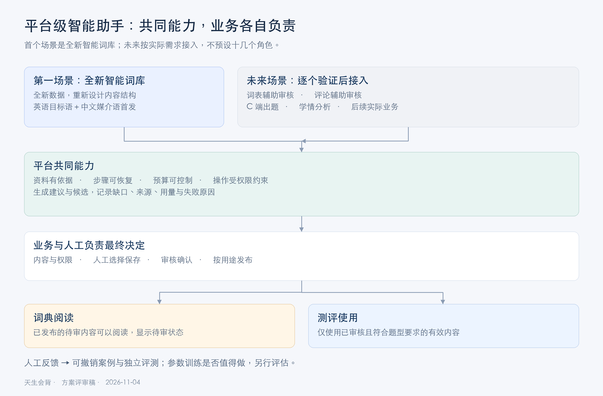
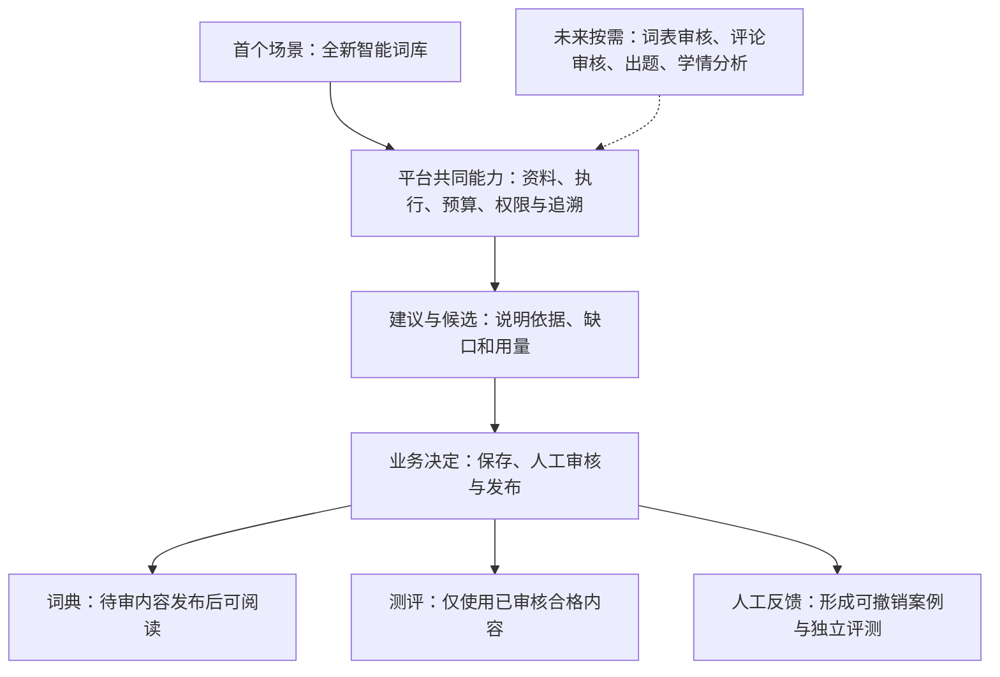
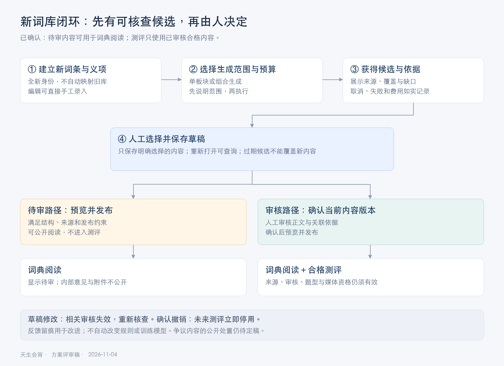
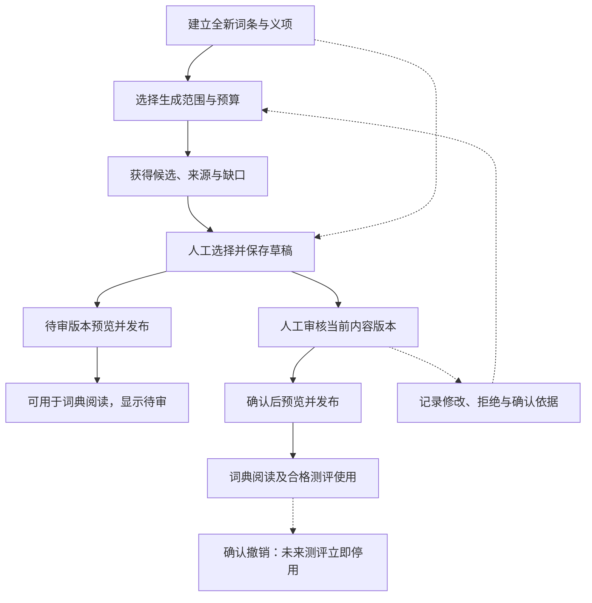

# 平台与新词库：业务评审图

日期：2026-11-04。这里说明业务分工与用户流程；工程架构和故障恢复见 [技术方案](design.md)。图中“未来场景”为方向，不是已授权实施名单。新词库使用全新数据，不迁移旧词库；首期英语＋中文。

## 1. 平台分工

[下载矢量图](diagrams/platform-business.svg)。公共平台帮助不同业务获得有依据、可控制、可追溯的智能执行；保存、人工审核和发布仍由各自业务负责。积累反馈先用于评测和有效案例，训练另行决策。

## 2. 新词库闭环

[下载矢量图](diagrams/lexicon-business-flow.svg)。待审可发布阅读已由用户确认；“有争议”不等同于普通待审，其公开处置见需求 D01。图中测评资格还需满足题型、来源和媒体要求。人工可直接编辑，AI 故障不应阻断编辑与发布。

## 3. 评审时先看什么

1. 第一闭环能否让编辑从空库走到真实阅读，并清楚区分候选、保存、审核、发布。
2. 第二业务能否共享平台能力，同时保留自己的输入、政策、权限和人工决定。
3. 费用与质量是否可衡量，失败时是否可恢复，是否需要训练由独立评测和投入产出决定。

本目录图替代之前包含旧数据迁移假设的业务图；未覆盖或改写旧导出目录的其他文件。PNG 为本地绘制的文档示意图，非 HTML 原型页面截图。
