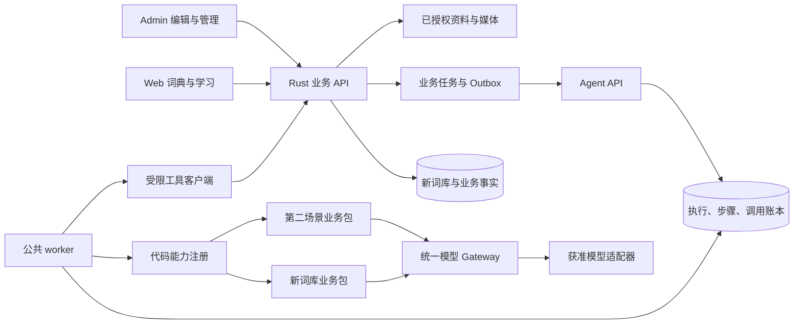
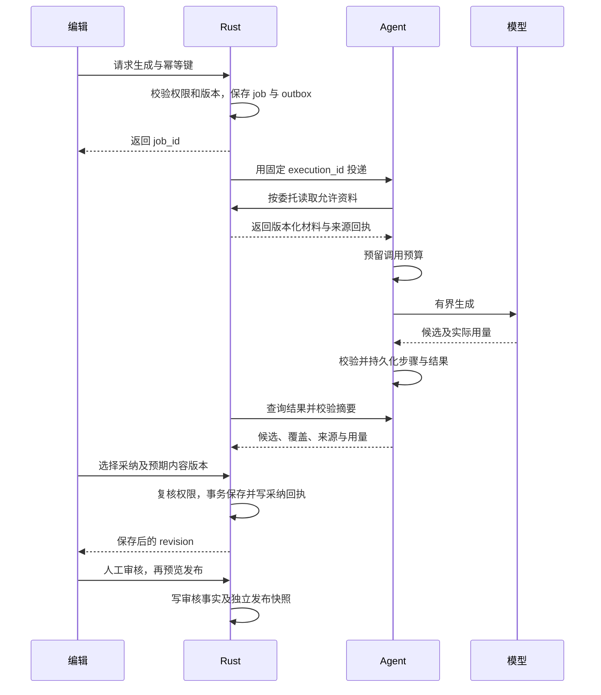

# 平台级 Agent 与全新智能词库架构方案

日期：2026-11-04。状态：完整平台仍为设计；本次仅实现第 6.2 节的语言基础及必要草稿容器。除第 6.2 节明确列出的语言基础外，表名、路径、类型与数值目标均为拟议方案；当前能力只以 [证据文档](evidence.md) 为准。产品范围和 D01–D09 决策见 [需求方案](requirements.md)。甲方图单列于 [业务图](business-diagrams.md)，本文件保留工程细节。

## 1. 结论与依赖地图

推荐保留 tsz-agent 作为独立于业务后端的**模块化单服务**，API 与 worker 可分进程部署，共用运行数据库；先以代码注册业务能力，复用已有租约、调用预算和账本，重新设计其业务无关接口。第一业务包是新词库；第二个差异场景验证边界后再扩展。首期不引入通用工作流 DSL，不按 Agent 数量拆微服务，不把现有命题数据结构扩成万能结构。

Rust 保持业务权限、领域事实、保存、审核和发布的最终权威；Agent 负责模型循环、任务执行、恢复和调用成本；前端通过 Rust 操作。该划分降低跨库一致性成本：Agent 能完成一次执行，但不能宣布词库已保存或已审核。

| 依赖                                              | 现状分类                     | 剩余工作与阻塞                                                  |
| ------------------------------------------------- | ---------------------------- | --------------------------------------------------------------- |
| 服务认证、FastAPI、SQLAlchemy、显式迁移、部署形态 | 主线已有，可复用             | 保持服务凭据只做服务身份；补业务委托，不扩大访问范围            |
| 租约、检查点、取消、调用预留/结算                 | 主线已有，改造复用           | 去命题耦合，补步骤版本、未知调用处置、业务维度、公平调度        |
| 模型接入与调用视图                                | 主线已有，改造复用           | 抽统一 gateway；助手/词形也接同一约束；现有账户适配不自动全保留 |
| 命题审核经验                                      | 机制可复用，业务 schema 重写 | 反馈中有直接命题校验和固定 capability；仅保留幂等/撤销机制      |
| 新词库领域模型、审核依赖、候选采纳                | 真正新工作                   | 新表新 ID；D01–D07 决定部分约束；无旧数据转换依赖               |
| 前端编辑、预览、用户阅读                          | 基础组件可复用，领域状态重写 | 共享 Admin 控件、认证、媒体编辑器复用；V3 表单/DTO 不直接复用   |
| 词表/学习接入新来源                               | 真正新工作                   | 现有消费者直接解码旧结构；需明确 source_kind 与新投影           |
| 第二场景                                          | 候选验证工作                 | 评论领域入口未在本次源码范围发现，须确认业务范围，不能假定现成  |
| 数据训练/蒸馏                                     | 未发现实现，可选新工作       | 先取得合法样本、冻结评测、证明质量/成本瓶颈；不阻塞首发         |
| 旧服务实际流量/部署                               | 未核实                       | 本轮不接生产；后续切换前只读核实，不据源码擅自停用              |

关键路径：政策与新模型 → Rust 新内容/任务契约 → Agent 公共执行 → 单词库真实闭环 → 第二场景检验 → 全部英语模块/新消费者。首个闭环和全模块是不同终点。

## 2. 源码审计摘要

本轮重新 fetch 后按精确 ref 读取：tsz `13b0e43ffcf9288407ce094878618c50239cd381`；Rust `fb0575d019e6eb98d722ee85279805deeb034a56`；Agent `dbe5936585708d0e7d8095d2a947edd8722f0a7d`。本地 Rust/Agent checkout 落后，不能作为主线证据。目标文档 worktree HEAD 与所核前端主线相同。

| 对象                                      | 处置                       | 判断依据与限制                                                                                                |
| ----------------------------------------- | -------------------------- | ------------------------------------------------------------------------------------------------------------- |
| API 生命周期、受控错误、认证              | 保留基础，小改动           | `app.py` 不启动迁移；共享 bearer 认证不等于用户/资源委托                                                      |
| `storage.claim/renew/checkpoint/complete` | 改造复用                   | 数据库时钟、SKIP LOCKED、lease_token fencing 已有；Run 的业务字段和结果仍属命题                               |
| `worker.run_once`                         | 重写调度边界               | 直接 import 命题 execute，内嵌模型选择和供应商特殊超时；保留租约心跳模式，不保留硬绑定                        |
| 调用预算、metrics、pricing、ledger        | 保留并统一                 | 发送前预留，取消/租约变化后仍可结算，未知成本保持 null；需补业务/步骤维度与并行原子预算                       |
| 命题 `QuestionModel`                      | 不作为公共模型协议         | generate/review 的返回类型绑定命题；底层 provider 适配和计量可复用                                            |
| `lexicon_assistant` / `form_candidates`   | 业务能力重写并迁入统一执行 | 两者直接使用 DeepSeek；Rust 中持有问答循环和工具执行；新领域输入重做，旧路由暂不动                            |
| `rules/lexicon_filling.md`                | 逐条再审，不原样迁入       | 旧格式、旧字段及填词规则不等于新领域的权威约束；机器约束应来自业务目录                                        |
| `ReviewCurrent` / `FeedbackEvent`         | 保留机制，替换业务 payload | revision 防乱序、撤销 active、幂等有实现；存储层却导入命题 validator，不能作为跨业务经验库直接复用            |
| `evaluate.py`                             | 改造为按能力评测           | 当前是命题专用、冻结标注 fixture、显式 `--live` 才付费；不是训练、也不是完整平台质量门                        |
| 旧命题 workflow                           | 旧路径隔离共存，迁入待定   | Agent 仓库仍有；Rust 主线已退役旧生成入口，当前学习出题走确定性逻辑。实际部署未核实，不关闭、不恢复已退役业务 |
| 账户连接/模型探测/OpenCode 等             | 按使用与稳定性选用         | 凭据管理和 probe 状态与公共 runtime 解耦；不以“已有实现”为由让所有业务依赖交互式登录或本地 CLI                |
| Rust 权限、发布事务、共享媒体             | 复用约束与基础服务         | 发布实现大量依赖 V3 DTO；新库需新的领域发布器，不能直接调用旧结构写入。媒体授权/引用机制逐接口适配            |
| Admin 助手面板、Web 阅读                  | 复用交互经验，改领域状态   | 助手输入和采纳计划绑定 AdminWordV3；旧阅读采用最近等级，与新原型不同                                          |

详细定位、真实调用链、测试断言及原型覆盖顺序集中于 evidence.md。审计是静态判断，未宣称运行测试通过、部署成功或生产仍在使用某功能。

## 3. 概念及架构备选

### 3.1 Agent、能力、任务、工作流

| 名称              | 本方案定义                                               | 例子                                                  |
| ----------------- | -------------------------------------------------------- | ----------------------------------------------------- |
| Agent             | 一组业务职责、规则、允许工具和模型策略组成的可执行业务包 | 词库编辑助手、候选的评论辅助审核                      |
| 能力 capability   | 有明确输入输出、权限、限额、版本和验收标准的操作         | `lexicon.generate_definition`、`lexicon.sense_bundle` |
| 业务任务 job      | 用户希望达成的结果及其适用范围，由业务管理               | 为 job 的某义项补充六级例句，最终是否采纳             |
| 执行 execution    | 一次固定版本和预算的计算，由平台管理                     | job 的一次生成尝试；可跨进程恢复                      |
| 工作流 workflow   | 该能力的步骤与依赖，通常由代码控制                       | 准备资料→并行生成等级→校验→汇总                       |
| 模型轮次/工具步骤 | 工作流中的一次外部调用或校验                             | 结构化输出、查已发布词义；并非都需要独立 Agent        |
| 会话 session      | 有边界、权限和过期规则的问答上下文                       | 编辑围绕同一草稿连续提问；不自动成为长期记忆          |

平台不要求每个能力都动态规划。顺序可确定时用普通代码；模型只在不确定的内容选择和受限工具选择处参与。

### 3.2 服务组织选择

| 方案                             | 优点                                               | 代价/适用条件                                                       | 决定                             |
| -------------------------------- | -------------------------------------------------- | ------------------------------------------------------------------- | -------------------------------- |
| 全放 Rust，Agent 仅模型代理      | 服务少，业务授权就近                               | Python 模型生态与执行恢复分散；多业务复制循环；Agent 平台目标难成立 | 不推荐作为目标；允许旧路径过渡   |
| 模块化 Agent 单服务＋独立 worker | 复用现有基础，共享账本；业务包可隔离；部署成本较低 | 需限制依赖方向、资源配额；坏能力可耗尽公共池                        | 首期推荐                         |
| 每个 Agent 独立服务              | 独立扩缩容、合规和发布                             | 十几个服务造成重复认证、恢复、账本与运维；当前需求不足以证明收益    | 达到明确隔离/团队/负载需求后再拆 |
| 立即引入完整工作流平台           | 长等待、跨服务事件及恢复能力成熟                   | 新基础设施、历史与版本语义、运维学习；不能消除业务幂等              | 保留替换接口，P2 后按证据决策    |

拆服务的触发因素是独立团队发布、敏感数据隔离、明显不同 SLO、特殊 GPU/网络环境或负载长期互相干扰；“超过十个名字”不是触发条件。可先分 worker 池再决定拆服务。

### 3.3 编排与耐久引擎选择

首期推荐代码注册＋显式步骤状态，复用 PostgreSQL 租约。只实现当前闭环需要的顺序、有界并行、条件分支、有限重试；业务人工采纳通常在 execution 完成后，无须让 worker 等人。需要跨天等待时，先持久化待决动作并释放租约，随后通过已授权事件恢复。

Pydantic AI 当前官方文档提供多个耐久执行引擎集成，但安装模型库本身不等于本项目已有持久化编排。人工 deferred tools 也不替代服务端权限验证。仓库锁定 `pydantic-ai-slim 2.62.0`、`FastAPI 0.162.0`、`SQLAlchemy 2.1.6`；文档是检索时当前版，具体适配 API 必须在实施前对锁定版本验证，不为本次评估升级依赖。[耐久执行](https://pydantic.dev/docs/ai/capabilities/durable_execution/overview/)、[Deferred Tools 权限边界](https://pydantic.dev/docs/ai/tools-toolsets/deferred-tools/)。

| 引擎选项                    | 适合当前的理由/保留理由                              | 何时改变选择                                                                        |
| --------------------------- | ---------------------------------------------------- | ----------------------------------------------------------------------------------- |
| 现有 DB 租约＋显式步骤      | 已有基础，首期少量有界流程，可避免新运维平台         | 出现大量跨天等待、信号/计时器、复杂补偿、跨服务子流程或频繁版本恢复事故时停止扩自研 |
| Pydantic AI＋Temporal       | 作为复杂耐久编排候选，工作流历史与 Activity 语义明确 | 先做断电/未知调用/版本变更小验证并评估运维；不单凭框架功能表决定                    |
| Pydantic AI＋其他 DB 型引擎 | 可作为降低运维成本的替代候选                         | 同样验证持久化、升级、授权与事件恢复，不在本轮泛化选型                              |

即使使用 Temporal，Activity 仍需幂等设计，外部模型调用的未知结果也不能自动变成 exactly-once；这是保留调用账本和业务采纳唯一约束的依据。[Temporal Activity Definition](https://docs.temporal.io/activity-definition)。

不同时让两个引擎共同拥有一个 execution。若后续切引擎，旧执行按原版本排空或受控失败，新任务才走新引擎；账本、业务 job 与候选协议保持稳定。

## 4. 推荐工程结构及权威边界

建议目录职责（不是本次文件变更）：`runtime/` 管任务与步骤；`gateway/` 管模型调用；`tools/` 管协议与委托；`capabilities/lexicon/` 等管业务推理；`feedback/` 管通用事件与案例生命周期；`evals/` 管能力评测。通用模块不能 import 词库 schema 或命题 validator；业务包可调用公共模块。业务写入规则只在 Rust 权威执行，Agent 的结构校验用于尽早拒绝非法候选，不成为另一份发布规则。

| 数据/决定                                        | 权威方                               | 另一方保存什么                                   |
| ------------------------------------------------ | ------------------------------------ | ------------------------------------------------ |
| 用户、资源权限、词库版本、词表/评论事实          | Rust                                 | 最小授权快照/引用、摘要、有效期                  |
| 生成业务 job、采纳范围、保存回执、审核/发布      | Rust                                 | job_id 与执行关联，不复制完整可写业务库          |
| execution/step、模型/tool 调用、重试、预算、费用 | Agent                                | Rust 保存可重建状态投影和回执摘要                |
| 来源许可证、业务材料授权                         | 业务资料管理侧                       | Agent 保留使用证据的引用和版本；不默认存受限全文 |
| 人工决定                                         | Rust                                 | Agent 幂等接收反馈事件，用作允许范围内案例/评测  |
| 规则/提示/工作流版本                             | Agent 发布制品；业务政策由 Rust 定义 | 每次执行固定版本；模型建议不能自行激活           |
| 公开可见与测评资格                               | Rust                                 | Agent 每次取得/交付来源时重新验证                |

外部公开资料检索不必永久穿过 Rust 热路径：权限和来源目录仍归业务侧，可用独立受控抓取适配器执行。首期不额外拆服务，禁止 Agent 拿到业务数据库连接、任意 URL/SQL 工具。

## 5. 最小平台协议与运行语义

### 5.1 能力定义与版本

代码中的 `CapabilityDefinition` 至少包含：`capability_id`、`version`、`input_schema`、`output_schema`、`workflow_version`、`prompt_version`、`tool_set`、`required_model_features`、`execution_mode`、`limits`、`feedback_schema`、`evaluation_suite`。只接受已注册组合，JSON Schema 严格拒绝多余字段；业务 payload 自有版本，不由一个全平台巨型枚举承载。

配置允许启停、授权模型集合、并发/预算上限、提示版本选择；不允许配置上传 Python、任意工具地址或修改业务审批政策。代码注册通过发布生效，配置变化审计化，新任务取快照，运行中任务不悄悄漂移。必须热修复时取消旧任务并明确新执行。

公共 envelope 不出现 `sense_id` 等领域必填项：`domain`、`job_id`、`execution_id`、`capability_id/version`、`actor_ref`、`scope_ref`、`input_version/hash`、`delegation_id`、`deadline`、`budget_policy`、`model_policy`、`trace_id`。actor_ref 是追溯信息，不能独自授权。

### 5.2 模型 Gateway

公共接口负责消息、结构化输出 schema、允许工具、模型特征、deadline 与预算；返回规范输出/工具请求、原始供应商请求标识、实际 usage、finish_reason、模型身份和脱敏错误。业务 prompt 与结果 validator 留在业务包。

能力特征包括：支持的结构化输出方式、工具调用/并行工具、上下文/输出上限、语言质量、流式、图片、可查询请求、幂等支持。支持字段合法不代表语义质量合格；供应商 SDK “可调用”不能代替平台评测。

每个调用先写 ledger 再发送；自动重试包含结构修复调用，统一扣预算。模型策略固定允许的 provider/model/fallback，所有 fallback 记录实际选择；不能跨数据许可边界或悄悄切账号。现有探测结果用来判“可用”，不能判“会做好新任务”。

不提前选训练供应商。本轮复用现有可用适配的方向不等于保证所有旧接入方式适合长期无人值守服务；生产接入需满足稳定凭据、配额、许可和可审计费用。

### 5.3 持久化最小模型

| 实体                    | 关键字段/不变量                                                                                                       |
| ----------------------- | --------------------------------------------------------------------------------------------------------------------- |
| executions              | id；domain/job；能力/工作流/模型策略版本；input_hash；状态/seq；deadline；lease_token/until；attempts；预算；结果摘要 |
| execution_steps         | execution_id＋step_key 唯一；依赖、input/output_hash、状态、步骤版本、尝试及错误分类；并行结果按稳定 key 汇总         |
| model_calls             | call_id 唯一；execution/step/attempt；reserved/sent/known/unknown；供应商回执；token、成本和价格版本；取消后仍可结算  |
| tool_calls              | tool_call_id、委托/工具版本、参数摘要、资源版本、结果引用、时间与结果；不得存完整 headers                             |
| artifacts               | 候选/来源/覆盖的有界产物，schema/version/hash；超大结果通过受控存储引用，不塞无限 JSON                                |
| feedback_events/current | 事件/业务决定 ID、revision、candidate/source、决定、原因、supersedes、有效性；业务适配器验证 payload                  |

物理上可以分批扩现有表；旧 `RunResult`、`ReviewEvent` 的命题字段保持在 legacy adapter，新的通用执行表不把旧 JSON 强制 reinterpret。迁移仅指以后显式新增平台 schema，不包含旧词库内容迁移。所有迁移都需单独实施授权；启动不自动执行。

建议执行状态：`queued → running → succeeded/failed/cancelled`；真正需要挂起时增加 `waiting_external`，记录 wait_token、期望事件、过期时间和输入版本。`partial` 是结果完整度，不是另一种业务审核状态；部分完成可以 `succeeded + completeness=partial`，结构全坏则 failed。人工采纳位于业务 job 状态，不能用 execution 的 succeeded 代表 saved。

### 5.4 调度、重试、预算与取消

- 首期数据库队列，租约由数据库时钟计算，更新检查 token 与有效期；保持过期 worker 无法写结果。优先增加领域/服务等级/供应商并发配额，不先建消息总线。
- 顺序步骤使用持久结果；并行步骤具有唯一 step_key，有限 fan-out，汇总逐步完成；分支决定持久化，恢复不重问模型以选择另一条路径。
- 重试只覆盖可恢复网络/限流等，指数退避加抖动并受 deadline/attempt/预算约束；非法输入、权限撤销、版本冲突、不可解释输出不无限重试。
- 供应商调用发送后无回执：标记 unknown。优先按供应商 request_id 查结果；无幂等/查询能力则结束该步骤等待明确重试，不能由租约恢复盲目重复付费。
- worker 崩溃前已持久化成功步骤直接复用；未发送 reservation 可安全恢复；执行版本不匹配由旧兼容 worker 处理或显式失败，不读错检查点。
- 预算同时限制调用次数、输入/输出 token、工具次数、条数、墙钟时间和并行数。已知单价才可做硬金额预算；未知价不能假装已保证人民币上限，应禁止该计价策略或只执行用户明确接受的调用/token 上限。
- 并行预留必须在事务内原子扣可用额度；恢复不重置预算。最终金额只有实际数据足够才给数值，同时报告未知调用数；费用估算和供应商账单不混为一谈。
- 取消令业务禁止后续采纳，Agent 停止新调用、协作取消已有调用；供应商不能取消的实际消耗仍记账。已完成任务的 execution 终态保持实际 succeeded，业务 job 仍可因取消而不可采纳。
- 关闭浏览器的观察流不取消耐久任务。即时问答默认短 deadline、断开后不再发新工具调用；明确记录部分回答，不能承诺重连精确复放；需要重开可恢复则显式使用耐久模式。

### 5.5 人工等待与权限

首期候选生成完成后由 Rust 管理待采纳/待审核，不挂起模型进程。将来“研究计划先人工批准再生成”用待决动作：Rust 保存拟执行范围、版本与决定；Agent 仅持有 wait_token。用户决定通过鉴权的 Rust 事件恢复，事件 ID 去重、revision 防乱序，恢复再次验证当前权限和来源；过期、内容变化或拒绝产生明确终态。

库的 `requires_approval` 不能代替上述机制，也不能将前端传入的“已批准”历史视为业务事实。禁止 Agent 自签批准或从聊天文本猜测审核成功。

### 5.6 运维与权限面

共享服务初期逻辑隔离即可：按业务、操作者资源域和数据级别隔离任务/产物/缓存/反馈检索；每次读结果也校验当前权限，不能只校验创建。学校/组织 ID 仅在实际业务有此边界时加入，不为未来泛造多租户计费系统。

首批仪表包括队列年龄、运行/挂起数、租约恢复、失败原因、unknown 调用、每能力成本、权限拒绝、审核时延和候选质量。只记录 trace/id/版本/脱敏错误；敏感正文保留于受控产物存储。运维可停用能力和模型，不获得业务批准权。备份覆盖运行 DB 与产物引用，恢复演练重点验证账本和采纳幂等；RPO/RTO 由 P0 结合可承担损失定量。

## 6. 全新词库领域设计

### 6.1 独立模型与存储

建议在 Rust 管理的业务库内建立独立 `lexicon_next` schema（逻辑名），全新 UUID 与独立路由；不沿用 V3 嵌套对象作为底层真模型。此处“新库”指新领域与数据集，物理独立数据库无现阶段必要；事务、权限、媒体引用需要与现有业务协作。

以稳定节点关系表存身份/外键/检索和生命周期，以版本化 JSONB 存经过严格 schema 校验的富文本/快照；不把全部词条塞进不可约束的 JSON，也不为每个 UI 字段建表。

| 实体/关系                                                 | 建议字段与约束                                                                                                                |
| --------------------------------------------------------- | ----------------------------------------------------------------------------------------------------------------------------- |
| entries                                                   | id、kind、target_language、headword、owner、revision、lifecycle、current_publication_id；同拼写不唯一；语言有内容后不可直接切 |
| entry_pos / form_groups / form_contents / form_bindings   | 新 ID；基本词性、词形类型、地区拼写、多读法、共享与适用义项；绑定有效性、共享范围与音频引用独立验证                           |
| senses                                                    | id、entry_id、pos_id、sub_pos、level_scale/value、range_id、sort_order、depends_on_context；不以标题/序号为主键               |
| semantic_ranges / range_labels                            | entry 内分类；每语言 label 稳定 ID、文本、词元片段/待关联；name 不是外键                                                      |
| grammar_structures / definitions                          | grammar 的 tokens 拼接等于 pattern；definition 绑定 sense、locale、style、level、grammar_id 或 null、rich_content、revises_id |
| equivalent_groups / equivalents                           | sense＋locale 的组，explicit_none 与未填区分；词、语体、行业及评分领域估计；scope 内去重，评分来源独立                        |
| sense_relations                                           | source_sense、kind、target_ref 或 pending_target、score；来源/目标有效性按生命周期验证，不能伪造目标                          |
| sentences / sentence_variants / translations              | 独立身份和草稿 revision；原文 locale、等级、标签、tokens；译文 locale、正文、freedom、origin；共同句子发布边界                |
| sense_examples                                            | sense＋sentence 引用，词元位置与适配信息；自身 revision/review，不复制原文；发布固定 sentence_publication                     |
| source_records / evidence_links                           | 资料身份/版本/定位、访问回执、许可和公开摘要；关联内容节点，禁止把来源 URL 本身当核验结果                                     |
| review_blocks / review_events                             | owner/node/locale/kind、内容与依赖 digest、状态、review_revision、policy_version；不可变事件与可查当前视图                    |
| publications / publication_refs                           | 不可变内容快照与 schema_version；固定引用版本、校验回执、资格摘要；当前可见性独立检查                                         |
| generation_jobs / candidates / adoption_receipts / outbox | 业务范围、输入版本、execution 绑定、候选摘要、取消意图、保存回执；唯一 candidate/目标防重复                                   |

关联约束必须同时保证资源归属：合法 UUID 并不足够；definition 的 grammar 与 sense 必须在允许词性/同一 entry 范围，例句引用与目标词元位置匹配，关系必须指向允许的新库发布义项。循环关系不等于无限递归响应，批量发布使用有限依赖检查。

新数据零起步导致首期合法关联候选不足，这是内容冷启动问题：允许 pending 草稿、显式“无相关项”、人工先补目标词；不能回填旧库或让模型创造已发布目标。生成新的释义可以原创，但用于测评的正确答案/干扰项只能引用 Rust 返回的有效已发布且审核合格来源。

### 6.2 语言基础的本次实现

词条 `target_language` 固定为 `en`，不提供原地改语种接口。`forms`、`definitions`、`equivalents` 各带真实内容 locale；当前编辑/预览选择不持久化为词条属性。共享义项及内容 ID，不创建四套词条。

能力目录只开放 en-GB/en-US 与 zh-Hans/zh-Hant；显式 `en` 内容可作英语通用回退。英文释义仍属目标语，简繁内容精确选择，不隐式转换或复制；英语媒介语和单语模式不开放。日/法/西语仅保留 Unicode 内容、语言代码及独立规则模块扩展边界，当前 API 拒绝。

独立 `lexicon_next` schema 包含 entries、永久 nodes、forms、senses、definitions、equivalents、draft_revisions。保存整份所有 locale 草稿，事务复核会话/所有权及 expected_revision；冲突不覆盖数据库或浏览器本地稿。旧库不迁移、不关联。schema_version 固定 1，无未校验扩展袋。

五个 Admin 操作：GET capabilities、POST entries、GET/PUT entries/{id}、GET entries/{id}/view。沿用 words.access/create/edit/edit_others，能力明确 generation=false、publishing=false。前端只增加共享 Admin 控件编辑器与对应导航；UI 界面语言独立于业务语言选择。预览不回写草稿。

后端 down 会删除本切片全部新库草稿/历史，属于有损回退；旧 schema 保持。旧后端无这些路径，新前端能力请求失败时关闭编辑；旧前端现有路径/响应不变。配套部署未授权，实际线上混合版本未验收，不能据本地测试宣称可发布。

#### 后续数值约束（未在本次实现）

freedom 建议 wire 十进制数且最多一位小数，内部整数 0–1000；以 `3 * value <= 1000`、`<= 2000` 派生类别。这样 33.3 属直译、33.4 属意译，66.6 属意译、66.7 属创译，0/100 合法。人工未评估 null 与 0 不同。禁止新接口接收 restoration 来猜测转换。

词频/译词常见度内部 1–999，关系分数 0–999；全部附估计来源/领域，不作为概率。文本位置统一 Unicode 码点，附原文 digest 与片段核验；原型 JS UTF-16 下标只作为功能参考，不直接导入。覆盖 emoji、组合字符、空格及重排失配样例。

### 6.3 审核与发布依赖

审核指纹至少含节点内容、语言/变体、方式、语法/词形适配、关联目标及依赖摘要、政策版本；排序若不改意义可不使正文审核失效。只有真正影响结论的依赖进入指纹，避免编辑一个无关译词使全库重审。

内容修改使该草稿板块及依赖板块待审；新草稿变化不自动撤销旧发布内容确认。审核人员明确撤销某个已发布版本的确认，则实时资格投影停止未来测评，并触发缓存失效。不可变 publication 内的旧审核回执保留为历史证据，不能单凭它永远判可用。

测评资格 = 当前公开有效 ∧ 当前相关审核未撤销 ∧ 内容/依赖与已审版本一致 ∧ 题型适用 ∧ 来源与媒体仍合法。未来新任务按当前资格取源；已经形成的答案快照保持原记录。严重问题影响进行中任务的处置由业务政策决定，不自动重算成绩。

发布事务核对当前用户、expected_revision、预览 digest、依赖、媒体、必填和用途资格，写 publication/引用/当前指针及 outbox；对相同 idempotency_key 和摘要返回同一结果。新库需实现此发布器，旧实现仅复用锁序、权限、媒体授权等可独立基础，不继承 V3 数据模型。

共享句子由自身所有者编辑/发布；词条编辑权不等于句子编辑权。正文及全部译文暂整组审核；义项引用适配单独审核。跨资源候选不能伪装一个事务全成功：首期逐资源原子保存并明确清单，先保存句子再保存引用，第二步失败保留句子和待处理引用，不补偿删除正常共享资源。

## 7. 生成、工具与业务写入契约

### 7.1 拟议接口面

以下路径为设计草案，必须由 Rust/Agent 原生导出工具生成正式 OpenAPI；前端只消费 Rust 契约，不直接消费 Agent DTO。

| 层         | 操作                                                                               | 核心输入/结果                                                           |
| ---------- | ---------------------------------------------------------------------------------- | ----------------------------------------------------------------------- |
| Rust 公共  | `GET /api/v1/admin/lexicon-next/capabilities`                                      | 本领域与 Agent 可执行能力交集、语言/限额/政策                           |
| Rust 公共  | `POST/GET /api/v1/admin/lexicon-next/entries`，`GET/PATCH .../{id}`                | 新实体及 expected_revision；不接受旧 V3 全量 JSON                       |
| Rust 公共  | `POST .../{id}/generation-jobs`，`GET .../generation-jobs/{job_id}`                | 能力、范围、基准 revision、草稿快照摘要、幂等键；返回 job_id/进度/候选  |
| Rust 公共  | `POST .../generation-jobs/{job_id}/cancel`、`.../adoptions`                        | 取消意图或 candidate_ids＋预期版本＋幂等键；返回实际终态/保存回执       |
| Rust 公共  | `.../review-blocks/{id}/decisions`、`.../entries/{id}/preview`、`.../publications` | 版本和内容指纹；审核/预览/发布互不代替                                  |
| Rust 公开  | `GET /api/v1/dictionary-next/entries/{id}`                                         | 发布白名单读模型与真实适用状态                                          |
| Agent 内部 | `GET /v2/capabilities`、`PUT /v2/executions/{id}`                                  | 幂等创建，完整固定能力/输入/委托/预算/模型策略版本                      |
| Agent 内部 | `GET /v2/executions/{id}`、`POST .../cancel`、可选 events                          | 状态 seq、步骤、completeness、产物摘要、usage；查询是恢复必需通道       |
| Rust 内部  | `POST /internal/agent-tools/{tool_name}`                                           | execution/delegation/tool_call_id、严格参数；返回授权数据/版本/来源回执 |
| Agent 内部 | `POST /v2/feedback-events`，后续 `.../resume`                                      | 幂等事件与 revision；resume 附业务签发的待决动作引用                    |

统一错误区分 `revision_conflict`、`candidate_stale`、`authorization_revoked`、`capability_unavailable`、`budget_exceeded`、`result_unknown`、`source_unavailable`、`invalid_output`；错误码稳定，用户信息可操作，不暴露原始异常/密钥。

### 7.2 端到端闭环

Rust 的 job 创建与 outbox 同事务；execution_id 在投递前固定，网络响应丢失后重投同 ID。Agent 对同 ID 同 hash 返回既有执行，不同 hash 返回冲突。Rust 单调应用 execution.seq，查询可重建投影；SSE/回调仅改善体验，不是唯一结果来源。

候选包含 candidate_id、output_schema_version、scope、input_digest、proposed_content、source_refs、quality_flags、coverage 和 requires_human_review=true。模型输出的临时局部引用由业务解析；真实业务 ID 由 Rust 校验或新建。候选不可宣称自己是已保存实体。

输入允许指定未保存草稿的有界快照，但它不会覆盖业务权威数据；先检查 base_revision 与权限，再记录 snapshot_hash。采纳时前端本地 hash 与 Rust 基准版本都要一致；不一致则重新比较或重新生成，不能把旧快照结果静默套新内容。无关字段变化也可先保守拒绝，细粒度重基不是首期必做。

### 7.3 工具目录与来源授权

首期建议工具：`lexicon.get_authorized_context`、`lexicon.search_published_senses`、`lexicon.validate_references`、`catalog.get_language_rules`、`materials.search`、`materials.read_excerpt`。每个工具有严格 schema、版本、读写分类、最大响应/调用数和可追溯结果；默认无 save/publish/approve 工具。

委托记录绑定服务主体、业务操作者、execution、资源范围、工具集合、输入版本、过期时间、调用额度。Rust 每次读取工具与交付/采纳结果都查当前权限；Agent 服务 token 只认证服务，不授予全库权限。查询搜索也应限定返回资源，不能先全库读出后让模型自律。

资料服务返回 `source_id/version`、locator、fetched_at、access_status、content_hash、license_scope、可公开摘要。访问成功只证明取得页面；必须再由可检查的摘录与内容关联支持“来源支持本结论”。原创不伪装引用，不可核实引用不自动改标原创。

外部抓取需配置来源白名单，校验协议、DNS/最终重定向地址、私网、大小和超时；不把敏感草稿放入任意搜索词。资料正文、评论和用户上传文本均是数据，不能改变工具权限。首期不实现无约束浏览器代理。

### 7.4 失败与竞争矩阵

| 故障点                          | 权威状态/恢复                                  | 不能发生的行为                       |
| ------------------------------- | ---------------------------------------------- | ------------------------------------ |
| job 已提交，Agent 创建响应丢失  | outbox 重投同 execution_id，查原执行           | 新建另一付费任务                     |
| 模型已发出，worker 在回执前崩溃 | call=unknown，查询供应商或明确等待重试决定     | 当作未调用自动重发并标费用为零       |
| 模型结果已持久化，Rust 未接到   | Rust 查询/重投收据，结果摘要一致               | 将任务永久丢失或重复生成             |
| 权限撤销/资料范围变化           | 工具拒绝，结果不再交付或采纳；保留最小审计     | 服务 token 绕过业务权限              |
| 内容版本变化                    | job stale，显式重新比较/生成                   | 覆盖新编辑内容                       |
| 取消先于采纳事务提交            | Rust 拒绝后续采纳；通知 Agent 停止新调用       | 迟到成功恢复可采纳                   |
| 采纳先于取消提交                | 回执显示已保存，取消只影响剩余候选             | 无声撤销已保存内容                   |
| 并行步骤部分失败/预算耗尽       | 可验证产物＋覆盖缺口；按策略 partial 或 failed | 将部分完成标完整成功                 |
| 保存请求成功但响应丢失          | 重试原采纳幂等键，返回同 revision/实体 ID      | 重复创建释义/例句                    |
| 新 worker 不认识旧检查点        | 兼容版本 worker 处理或明确不可恢复             | 用新工作流解释旧检查点               |
| 共享例句保存成功、引用保存失败  | 记录逐资源回执，提示待完成引用                 | 声称整体成功或删掉共享例句补偿       |
| 审核撤销事件延迟                | 取源/采纳时业务实时检查有效性；反馈最终对账    | 因检索缓存延迟继续把撤销例当有效规则 |

## 8. 新旧模块与下游接入

新库无历史映射表、无双写、无 V3→Next 转换器。旧库、新库各自权威数据和历史可读路径隔离；新库参考资料也不能偷偷等同于旧词库业务内容。若以后人工导入旧内容，那是新增范围，需要另定许可和审核，不在本估算中。

| 消费者            | 接入方案与限制                                                                               |
| ----------------- | -------------------------------------------------------------------------------------------- |
| Admin             | 独立新词库入口/路由；共用认证、布局和媒体控件；旧编辑器不能访问新资源写接口                  |
| 用户词典          | 新读模型白名单投影；新旧入口显式选择或通过 source_kind 区分，不能仅按拼写合并                |
| 词表              | 新条目引用 `(source_kind, entry_id, publication_id)`；旧项目保持原语义，新来源用独立投影适配 |
| 学习/测评         | 新 source adapter 输出规范题源与不可变答案快照；读取时验证当前资格，学习历史不重算           |
| 共享例句/媒体     | 新例句身份；媒体平台可复用，但所有资产归属、授权、发布和引用登记重新验证                     |
| 旧 Agent API      | 旧 consumer 如仍存在继续走旧适配；新 execution 与新输入分版本；不把旧检查点改为新 workflow   |
| 导入导出/运营脚本 | 新命名空间严格解码；旧工具遇到新 source_kind 明确不支持，不丢字段后继续保存                  |

兼容组合：新前端＋旧后端不开放新入口；旧前端＋新后端维持旧路由；新库功能关闭不影响旧模块；新 publication 只有具备新 source adapter 的消费者才能使用。新旧 API/worker 混合部署必须通过能力协商与版本 fixture；不使用全局宽松 JSON 解码伪造兼容。

回退指关闭新任务入口、停止新执行、回到前一兼容版本，新库已写事实仍留在支持版本中可读；不回写旧格式、不删除已发布新内容。旧模块何时退场以消费者盘点、在途任务、资产引用及回退证明为前提，需单独决定。

## 9. 数据积累、评测与训练路线

### 9.1 从业务记录到可用资产

| 记录       | 保存什么                                                                             | 用途/禁止推断                                                |
| ---------- | ------------------------------------------------------------------------------------ | ------------------------------------------------------------ |
| 执行证据   | 最小输入快照或引用、版本、模型/规则、工具结果引用、候选、usage、时延、失败分类       | 重现与诊断；不保存密钥、完整 headers、原始异常或隐式思维链   |
| 人工反馈   | candidate/内容版本、原候选与修改 diff、采纳/拒绝/确认/撤销、原因码、证据、操作者角色 | 质量与修改成本；未采纳不自动判负，采纳不自动判正确           |
| 案例索引   | 适用能力、语言、规则版本、正负标签、来源版本、当前有效性                             | 受限检索；先过滤权限/有效性再排序，不跨学生/组织检索私有材料 |
| 规则候选   | 从多个事件归纳的问题、支持与反例、范围                                               | 人工批准后发布新规则版本；不自动把模型总结写入生效规则       |
| 数据集版本 | manifest、许可、脱敏、样本/家族 ID、分割、标注协议、撤销映射                         | 评测/SFT/偏好/蒸馏分别标记用途，不以运行日志替代清洗         |
| 模型制品   | 基座/训练方法、数据 manifest、超参、评测结果、部署许可及回退版本                     | 可审计实验；没有权重/adapter 产物不能报告训练完成            |

对每条人工决定采用 event_id 幂等、decision_id＋revision 单调、source_digest 验证；撤销停用 current，迟到旧事件不能复活。领域适配器判断词义、评论或学情语义，公共存储不导入词库校验器。检索前实时核查关键来源，断网无法核查时保守不使用。

首期结构过滤＋精确范围案例足够；只有检索遗漏确有质量影响才加向量索引。旧命题“SQL 最多取12、来源核验后最多选4”的机制可借鉴，四条不是所有新业务固定最佳值，需按 token 预算及消融评测选择。

### 9.2 数据治理与撤销

D09 冻结保留期限及访问职责；建议原始敏感输入短期受控保留，脱敏指标较长期，业务历史按原业务政策。资料必须分别标记可访问、可摘录/公开、可检索缓存、可训练、可用于教师生成；缺某权限就不进入对应用途，不能因公开网页可读就默认训练许可。

训练 manifest 必须能从 sample_id 追溯到来源和所有派生数据集/模型。撤销后删除或隔离检索索引、缓存和未来训练样本；已训练权重不能靠删日志精准“忘记”，需评估停用、回退或重训。对无法承担此义务的敏感数据优先不训练。学生数据以聚合/假名化最小集分析，训练另行许可，个人身份映射留业务侧。

评测集在检索、提示优化、训练和教师生成之前划分。按词族/义项簇、共享例句/源文档、评论会话或学生/时间窗分组隔离，防同义改写跨集合；隐藏测试集不进入案例库。版本变更时保留长期回归集和新分布测试集，不能反复调同一隐藏集后仍称独立评测。

### 9.3 先评测，再决定是否训练

建立无模型规则基线、现有模型＋提示、提示＋工具/案例、候选训练模型四个可比较版本；输入、来源版本、预算一致，按难度和长尾分层。机器校验结构/引用，盲审语义/教学质量，抽取双人样本校准标注分歧；模型裁判只能辅助，不能充当唯一正确标签。

| 场景 | 核心评测与实际价值指标                                                                         |
| ---- | ---------------------------------------------------------------------------------------------- |
| 词库 | 混义/编造来源/目标词泄露/等级偏移率，来源支持度，六级覆盖，人工改动时间与确认率                |
| 评论 | 各政策类别 precision/recall、严重漏检、误杀、拒判/转人工、申诉推翻率；类别不均衡不能只看准确率 |
| 词表 | 缺项/错误引用召回、误报、建议可解释性、审核员节省时间                                          |
| 出题 | 单一正确答案、干扰项合法且无歧义、题源资格、无泄露；不足候选是合法结果                         |
| 学情 | 数字和结论可追溯、缺失说明、跨人泄漏为零、建议适当性；不将语言流畅度当诊断准确性               |
| 公共 | schema/权限/状态机风险、p50/p95 耗时、可用结果率、每个已审核合格产物成本、人工接管率           |

P0 可从每能力 50–100 条分层样例做探索基线；发布样本量由要检测的错误率/提升幅度决定，不能把这个起步数量当统计保证。关键越权/无依据引用/错误审核状态的构造样例必须全部符合约束；质量阈值、置信区间和容忍度在看候选模型结果前冻结。报告分母、排除样例和 unknown 成本比例，不仅给平均分。

### 9.4 路线选择门槛

| 手段                      | 适用问题                                    | 开始条件                                                                            | 不做/停止条件                                                |
| ------------------------- | ------------------------------------------- | ----------------------------------------------------------------------------------- | ------------------------------------------------------------ |
| 规则/工具/案例检索        | 业务事实、格式、可变化政策、少量重复错误    | 有权威接口和审核案例；先做消融对比                                                  | 提示无限增长、案例冲突或隐私越界时收缩                       |
| SFT（含可选参数高效微调） | 稳定输出结构、教学表达、稳定工具使用模式    | 基线瓶颈是可学习行为；合法一致示范覆盖难例；学习曲线随数据增加仍改善                | 错误源于缺事实/权限/流程，标签不一致，样本不足或任务频繁变更 |
| 偏好训练（如 DPO）        | 多个合法答案中有稳定的质量偏好              | 同一输入和证据下的 chosen/rejected 及原因；标注一致，能排除长度/风格捷径            | 只有点赞、不同输入或过期证据，偏好无共识；先修标注而非训练   |
| 蒸馏                      | 教师已足够好但成本/延时高，希望部署较小学生 | 教师质量在独立评测合格；许可允许；有稳定流量与成本模型；学生仍保留相同工具/权限门禁 | 教师不可靠、只有零星调用、学生长尾退化、服务成本高于收益     |
| 在线 RL/自动训练          | 高价值且可可靠打分的特定问题                | 另立项、真实奖励定义、安全实验环境                                                  | 当前阶段不采用，避免用模型自评当奖励自我强化                 |

SFT 是利用监督示范更新参数；DPO 用同输入的偏好对优化选择，两者并不是把历史案例加入提示。[TRL SFT](https://huggingface.co/docs/trl/sft_trainer)、[TRL DPO](https://huggingface.co/docs/trl/dpo_trainer)。

蒸馏应区分“教师生成答案→审核过滤→学生 SFT”的输出蒸馏与需要 logits/概率的软目标蒸馏；只拿到 API 文本不能假定获得教师 logits。若只缓存或检索教师答案，未更新学生参数，则不是模型蒸馏。软目标机制参考 [PyTorch 知识蒸馏教程](https://docs.pytorch.org/tutorials/beginner/knowledge_distillation_tutorial.html)。

训练投资核算：`月净收益 = 月调用量 ×（教师每次总成本 − 学生每次总成本）− 学生固定托管/监控成本 − 增量审核维护成本`；总成本含重试、资料、失败和人工处理。回本月数 = 数据/训练/工程一次性投入 ÷ 正的月净收益。收益≤0 或质量不达标就不推进；无真实流量与价格时不报伪精确费用。

合格实验依次经过离线冻结评测→影子比较→小流量灰度→回退演练。模型/adapter 和规则分别版本化，一键回原模型；模型参数无法替代当前权限检查、内容发布和来源撤销。

## 10. 阶段、验收与实施检查

| 阶段 | 可交付终点                                        | 必须验证                                                         | 主要风险                                     |
| ---- | ------------------------------------------------- | ---------------------------------------------------------------- | -------------------------------------------- |
| P0   | 新领域模型/协议、来源与政策、基线样例、量级及预算 | 契约可表达无旧数据闭环；确认项与建议区分                         | 未决政策扩范围，内容人员不足                 |
| P1   | 最小公共执行＋单词库闭环                          | 请求丢失/重复、崩溃恢复、取消/采纳竞争、权限撤销、发布与测评资格 | 对旧 runtime 可复用度过于乐观                |
| P2   | 差异第二场景适配结论                              | 非词库 payload、独立 validator/反馈、相同账本/调度、公平限流     | 只复制词库模板导致虚假复用；评论业务尚不存在 |
| P3   | 英语＋中文全部模块及选定消费者                    | 完整原型规则、来源、共享例句、读写/审核并发、语音资格、预览一致  | 内容规模、多译文质量及人工审核成为瓶颈       |
| P4   | 独立扩展立项                                      | 新语言/新 Agent/引擎/训练的专项收益与风险证据                    | 过早通用化或用“训练”代替事实与规则治理       |

P1 首个闭环可用小批次释义和译词，不必先完成每义项上百例句；但执行协议从开始表达部分产物、覆盖与预算。P2 是为验证复用，不是授权上线评论自动封禁。首发完整英语内容与新消费者按已同意范围验收，新语言和模型训练另算。

2026-11-04 初始评估仅做文档格式、引用、版本、图源和范围一致性检查；2026-11-11 语言切片的实际代码与联调结果见 evidence 第 7 节。以后实施 Agent 时须执行项目要求的 `uv run ruff check`、`uv run ruff format --check`、`uv run mypy`、`uv run pytest`、契约导出漂移检查与构建；集成测试只连独立本地 `tsz_agent_test`。Rust/前端按各仓规则执行定向检查与最终门。Mock、真实 Rust 联调、真实模型质量验证和部署验收分别报告。

测试资产与样本使用专用测试前缀/唯一批次，预先验证列举、版本读取和永久删除权限；正常/失败/中断均清除对象所有版本、标记与专属登记。无权限不以生命周期代替清理。初始评估未创建业务测试数据；语言基础收尾只用独立临时数据库，无 OSS 对象。

## 11. 重新估算与人员假设

以下为剩余工程工作估算，不是交付承诺；以熟悉三仓的 1 名 Python/Agent 工程师、1 名 Rust 工程师、1 名前端工程师、0.5 名 QA，以及约 0.5 名产品/词典内容专家持续参与为假设。人日表统计工程/QA；内容生产与日常审核另列，不能认为开发完毕就拥有完整新词库。

不含旧数据迁移、不默认移植退役命题、不含所有语言/所有未来 Agent、训练算力/来源许可/大规模标注。范围为平台基础＋首期完整英语/中文词库＋选定词典/词表/学习新来源适配；第二场景单列。工作包包含自身单元/定向验证，集成包只计跨层验证，避免重复计算。

| 工作包                 |    人日区间 | 内容/排除                                                  | 置信度                              |
| ---------------------- | ----------: | ---------------------------------------------------------- | ----------------------------------- |
| A 产品定稿与三端契约   |        8–12 | 新领域、权限/用途、失败协议、样本；无历史迁移映射          | 中                                  |
| B 平台公共基础         |       25–38 | registry、通用运行/步骤、gateway、账本、工具委托、基础运维 | 中：已有机制可借鉴，schema 仍需拆耦 |
| C 新词库后端           |       25–38 | 全新内容表、草稿/候选采纳、审核、发布、来源/媒体适配       | 中低：原型细节多，发布依赖复杂      |
| D 新词库前端           |       25–38 | Admin 编辑审核候选、Web 阅读、预览、版本/异常体验          | 中：复用控件，重写领域状态          |
| E 词库专属 AI 能力     |       18–28 | 问答/词形、各板块与组合、来源流程、有界分级生成            | 中低：语义质量待真实样本验证        |
| F 评测与反馈基础       |       10–16 | 通用案例生命周期、词库样例与评分/版本工具；非训练          | 中低：高质量标注投入另计            |
| G 跨层集成与可靠性验收 |       14–22 | 版本契约、失败恢复、授权/并发、真实联调与质量回归          | 中低                                |
| H 消费者接入与上线准备 |       10–16 | 新来源词典/词表/学习适配、开关、回退和运维说明             | 中低：消费者范围须冻结              |
| 合计                   | **135–208** | A–H；工程/QA总工作量，非日历天                             | 中低                                |

135–208 的算术：最小 `8+25+25+25+18+10+14+10=135`，最大 `12+38+38+38+28+16+22+16=208`。旧 110–195 和 70–130 属不同范围，不能通过简单加减迁移项转换为本范围承诺。

阶段预算映射：P0＋P1 最小平台和词库样板约 **45–65 人日**，是 A–H 的子集；其余英语完整模块与接入约 **90–143 人日**，两者相加才是 135–208。P2 第二场景额外计算如下，不再把它混入平台基础。约 3.5 工程/QA 有效人力、每周 5 日时，135–208 人日理论下限约 8–12 周；考虑关键路径、内容反馈与并行折损，计划窗口建议 **12–18 周**。P1 约 4–6 周；加入第二场景及其业务前提后总体可能 13–21 周，不能将总人日机械除满员数承诺日期。

| 后续增量                |   人日区间 | 前提与不包含                                                                  |
| ----------------------- | ---------: | ----------------------------------------------------------------------------- |
| 评论审核影子 Agent      |      10–18 | 有版本化评论输入、政策和反馈入口；含分类/证据/评测/权限适配，不自动隐藏或删除 |
| 评论业务基础缺失        |  另加 8–15 | 只补最小事件/审核/反馈适配；若要完整评论产品需另估，不能靠此行覆盖            |
| 词表辅助审核 Agent      |       8–14 | 复用现有提交/人工审核，新增建议和证据，不重建词表系统                         |
| C 端模型辅助出题        |      15–25 | 先证明确定性算法不足；合法题源、缓存/预生成、质量及延时评测，非旧命题原样搬迁 |
| 学情分析 Agent          |      18–30 | 已有可靠授权统计接口；数据清洗/新指标平台不足另计                             |
| 简单同类新 Agent        |       5–10 | 只增加 schema、规则、现有工具组合、评测；不是所有 Agent 的统一单价            |
| 新工具/复杂审批的 Agent |   12–25 起 | 跨业务写动作、高风险授权、独立数据治理可明显增加                              |
| 一种新增媒介语          |  8–15 工程 | 具备编辑与审核人员；内容翻译/标注另计                                         |
| 一种非英语目标语        | 20–40 工程 | 词性/分词/语音/等级/题型都需验证，低置信度                                    |

可选训练独立估算，不属于135–208：

| 训练阶段                          |       人日 | 依赖与成本边界                                                      |
| --------------------------------- | ---------: | ------------------------------------------------------------------- |
| T0 数据许可、清洗、分割与基线补齐 |       8–15 | 已有运行/反馈记录；不含大规模人工标注                               |
| T1 单任务 SFT 小实验              |      10–20 | 在 T0 后，少量超参/数据量试验、冻结评测、可回退制品                 |
| T2 偏好训练实验                   | 另加 10–20 | 可用同输入偏好对；可跳过，不是 SFT 必经步骤                         |
| T3 单任务蒸馏实验                 |      15–30 | 教师已合格；T0 可复用，可能复用 T1 工具，不能与 T1 不加区分重复相加 |
| T4 灰度、监控与回退               |       8–15 | 只对通过质量/成本门槛的制品实施                                     |

一条 SFT→灰度路线约 T0+T1+T4＝26–50 人日；蒸馏→灰度约 T0+T3+T4＝31–60 人日，偏好训练按必要性另加。GPU/教师生成/托管费用未选模型也无规模，保持未知，实施前按 token、GPU 时长、实例数量单独报价。

人工内容工作以样本测时：`总工时 = 原创/修订条数 × 单条分钟 + 审核条数 × 审核分钟 + 争议返工`。P1 先量 20–30 个代表性新词条的人工耗时，再决定批量生产计划；它是后续建议，不是本轮已创建内容。若 D05 来源授权、D06 产量或 D08 消费者范围扩大，需重新估相应包；偏差超过 50% 先报告原因与剩余关键路径，不隐瞒在“平台化”中。

## 12. 评审顺序与终点

建议先审三个可分开决定的问题：职责边界/模块化单服务是否接受；P1 最小闭环是否覆盖真正业务风险；D01–D09 中影响首发的政策是否可执行。再审完整范围及工作量，最后讨论是否值得训练。不要先锁供应商或训练方法，再反过来设计评测。

完整方案评审的完成条件：确认项一致、没有旧数据迁移主线、代码审计可定位、平台与业务状态唯一归属、失败恢复可推演、第二场景可检验复用、训练门槛及估算拆开。完整平台性能、真实模型质量和部署仍待后续授权验证；本次语言切片的浏览器验证以 evidence 第 7 节为准。
