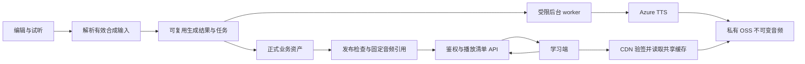

# 智能词库语音生命周期与分发评估

日期：2026-10-28。阶段：评估已完成，2026-10-28 用户授权开始实施；当前已完成基础复用、读取侧 URL 复用，以及词条音频检查/确认接口的本地实现与验证；最终发布门禁和单条审听页面已接入，正在补齐批量界面与受影响回归；完整方案尚未达到交付条件。未更改云配置或业务数据，未做容量压测或产生真实 TTS 费用。

## 1. 结论与边界

面向几万注册用户，推荐「发布前准备正式音频 + 按有效合成输入复用 + 私有 OSS / CDN 分发 + 有限后台生成任务」。复用现有 Rust、PostgreSQL、Redis、OSS 与 Azure，不因注册用户数单独引入 Kafka、分库或 Kubernetes。

正常播放只消费已发布的音频文件；用户增长不应直接增加 TTS 调用次数。TTS 消耗取决于新增内容、有效配置变化、明确要求的重新生成和失败重试。音频文件长期保留由业务引用决定，签名 URL 到期只刷新访问凭证。

用户已明确规模是「几万注册用户，部分每天使用」。日活、峰值并发、平均文件大小和播放频次尚无实测；下列是容量预算与验收目标，不是已证明的承载能力。

范围覆盖词形拼写、IPA／UPS 发音、语法、释义、共享例句及其已发布读取。用户私有词表音频复用任务调度与分发设施，但保持独立权限、计费、退款和删除语义；不直接并入全局公共内容去重域。上传真人录音不按文本合成指纹去重。语音克隆、实时对话与离线整库下载不在本轮。

## 2. 证据、已有能力与缺口

前端基线 `520a018923cdc86bdf985f71138a37420568faa8`；后端工作副本 `d6a3dab`，已对比 `origin/main 83eacd639b88fb534dae21501cb62ab2bab76926`，其差异集中在 OpenCode 管理功能。此前本会话读取测试服 manifest：前端 `f9ab7f93455387ed62ff8ae83c4761a97dcfd393`，后端 `a5354f4cdb43872356a46d25f8f12b02aae121b6`。这些是调查时版本，不代表后续部署状态。

真实样本：endurance 于 2026-10-27 01:03（UTC+8）由杨老师发布。发布快照与当前编辑投影一致：8 条发音仅 `endurances` 美式绑定正式音频；`endurances'` 两侧未保存单独音色配置。对应正式资产仍有草稿和发布引用。不能由此推断老师从未试听，也不能将该样本比例外推到全库。

| 能力         | 分类                 | 已核实情况与剩余工作                                                                                                                                                     |
| ------------ | -------------------- | ------------------------------------------------------------------------------------------------------------------------------------------------------------------------ |
| 临时试听     | 已有、可复用         | `speech/preview` 按请求指纹查缓存，TTL 24 小时，Redis 锁合并并发；没有命中时合成。需接入统一有效输入标识与可晋升结果。                                                   |
| 正式音频     | 已有、可复用         | `audio_assets`、`audio_generations`、pending/ready/failed、来源和配置记录、幂等请求已存在。不能重建一套平行资产系统。                                                    |
| 内容级复用   | 新工作               | `generated.rs::existing` 按管理员和 request_id 查询，主要防重复提交；不同请求的同效果音频没有在此路径全局复用。已有 effect_hash 可作为统一标识的基础，但须补版本化规范。 |
| 发布引用     | 已有、需补门禁       | 发布快照和引用表保护历史资产；样本证明音频缺失仍能发布。需定义哪些槽位必需，并保证它们在发布前 ready。                                                                   |
| 推荐变更任务 | 已有、可扩展         | `audio_updates` 已有持久任务、租约、有限重试、revision 校验；现有规则只替换继承的草稿音频，发布版本不自动变化。沿用这一规则。                                            |
| C 端播放     | 已有、需优化         | `Content.tsx` 使用 asset_id 请求签名；后端 `dictionary/handler.rs::audio` 校验当前发布引用并签发 OSS URL。没有即时 TTS 回退。缺正式音频通常不出现播放入口。              |
| 播放鉴权效率 | 小到中等改动         | `AudioButton.tsx` 每次点击重新签名；后端加载词条内容后检查音频数组。增加客户端 URL 复用、批量解析与精确引用索引，避免每次点击重复加载完整词条。                          |
| CDN          | 尚未核验部署配置     | 已核实代码签发对象存储 URL；不能据此断言云端没有 CDN。实施前查实际域名、回源、鉴权顺序、缓存规则和费用。                                                                 |
| 回收         | 已有、需适配共享结果 | 当前正式资产零引用有 7 天宽限期、行锁和标记保护；历史发布仍引用的资产不会按年龄删除。共享生成结果引入后必须扩展引用与任务租约保护。                                      |

相关代码：前端 `apps/admin/src/features/dictionary/word-creation/PronunciationPreview.tsx`、`apps/web/src/features/audio/AudioButton.tsx`、`apps/web/src/features/dictionary/Content.tsx`；后端 `src/speech/generated.rs`、`src/speech/preview/service.rs`、`src/speech/audio_updates/worker.rs`、`src/dictionary/handler.rs`、`src/lexicon/audio_assets/cleanup.rs`。既有产品规则见 [音色库主记录 §12](../voice-library/README.md#12-2026-10-26-最新需求实施计划)。

更正此前讨论：后台预览会重新合成，不代表当前 C 端每次播放会调用 Azure。当前问题包含后台重复生成、正式音频覆盖不完整，以及分发路径缺少容量验收，三者要分别解决。

## 3. 容量与成本模型

假设每位日活用户每天请求 200 次短音频，每次平均下载 40 KB（十进制，含可能预取的音频请求需另计）；按完整下载、不扣客户端缓存计算。峰值学习用户每 5 秒请求一条音频。注册用户数不能直接推导日活或峰值。

| 情形     |   日活 | 日播放请求 | 日流量 | 30 日流量 |
| -------- | -----: | ---------: | -----: | --------: |
| 起步     |  1,000 |    200,000 |   8 GB |    240 GB |
| 规划基准 |  5,000 |  1,000,000 |  40 GB |    1.2 TB |
| 增长预算 | 10,000 |  2,000,000 |  80 GB |    2.4 TB |

| 同时学习人数      | 音频请求速率 | 平均有效载荷带宽 |
| ----------------- | -----------: | ---------------: |
| 500               |    100 次/秒 |          32 Mbps |
| 2,000（首期验收） |    400 次/秒 |         128 Mbps |
| 5,000（扩展验收） |  1,000 次/秒 |         320 Mbps |

以上未计 TLS/HTTP 开销、重试、集中开课突发和长例句；若平均 80 KB，流量和带宽翻倍。请求按用户行为成簇，压测必须模拟突发，而不是只验证平均带宽。注册规模不是数据库或 CDN 容量承诺。

存储示例：50,000 个词条 × 平均 4 个词形 × 2 个口音 × 1 个正式音色 = 400,000 个文件；40 KB/文件约 16 GB。三个正式音色约 48 GB。例句、历史版本、真人录音、候选试听及 OSS 非当前版本另计；这是举例，不是当前词库清点结果。

月成本应拆成：CDN 下行 GB × 实际单价 + 请求费用 + OSS 回源流量/请求 + 存储 GB·月 + TTS 按实际模型计量的生成量 + 应用与数据库资源。CDN 命中降低回源，不会消除给用户的下行流量账单。TTS 应按新增有效输入与真实重试计费，不能按日播放量估算。未取得资源地区、合同价格及当前账单，本次不提供伪精确人民币报价。

首期上线前采集 7–14 天的播放次数、文件大小分位数、活跃时段、唯一音频数、重复播放比例与供应商生成计量，替换这些假设。

## 4. 备选方案与选择

| 方案                                    | 优点                                     | 主要问题                                                               | 判断         |
| --------------------------------------- | ---------------------------------------- | ---------------------------------------------------------------------- | ------------ |
| 仅延长试听缓存到 30 天/永久             | 改动小                                   | 不保证发布完整性、音色固定或跨请求复用，回收失去边界                   | 不作为主方案 |
| 用户首次播放时生成                      | 减少预生成                               | 冷请求延迟、供应商故障传到学习端、并发与费用失控；违背既有正式读取路径 | 不采用       |
| 所有词形 × 所有音色预生成               | 读取简单                                 | 大量无用组合，推荐变更放大重建，审批与费用难控                         | 不采用       |
| 发布所需音频预生成 + 有效输入复用 + CDN | 声音固定、成本随内容增量增长、播放可扩展 | 需发布门禁、历史补齐和完整生命周期                                     | 推荐         |

## 5. 推荐架构与不变量

核心不变量：已发布必需槽位有可读的正式资产；播放入口不调用 TTS；已发布资产字节不被同路径覆盖；URL 过期不等于资产失效；Redis 丢失不造成正式音频丢失；权限与复用独立；被历史发布引用的文件不因过期缓存而删除。

### 5.1 发布准备、审听与生效

服务端先依据一个确定的草稿 revision，解析板块/全局继承、口音、具体读法、已选音色顺序和全部有效参数，形成待发布清单。包含有独立读法的词形，不能按词面去重或跨口音替换。

建议规则：凡正式页面承诺可播的内容，以及显式启用的配音版本，都应生成并固定；未启用候选不生成。首期至少保证词形与指定读法的目标口音默认音频齐全；语法、释义和例句是否全部必需是产品决策，不能由“存在英文文本”自动推导。人工录音沿用已选择资产。

顺序：准备清单 → 复用匹配且已验证的音频 → 缺项入队 → 生成与完整性检查 → 编辑审听/确认 → 短事务复核并发布。发布按钮可呈现“准备音频”和进度，但机器生成成功不能冒充老师审听。是否要求每个自动生成项逐条确认，需确定业务门禁；至少声音选择或读法有歧义的项必须人工处理。

最终事务校验草稿 revision、推荐/读法依赖 revision、清单 hash、资产 ready 状态和回收标记，固定音色参数与音频 ID，并切换 current_publication。生成在事务外进行；准备期间修改内容则旧清单失效或复用仍匹配的项。多项中一项失败时保持旧发布可用，不能先切换到不完整的新发布。

### 5.2 统一有效输入身份

从现有 effect_hash 演进，维护带版本的 recipe_key：供应商、实际 provider_voice_id、可获得的模型/供应商版本、目标语言/原生 locale、最终规范化 SSML（涵盖 IPA/UPS、停顿、替换读法）、实际生效参数、输出编码/采样率、构建器版本；包含复用权限域。

规范化必须由服务端统一完成。只移除确实不影响合成的教学标记与显示名称，不能随意删标点、空格、Unicode 差异或 SSML 元素。用契约测试证明等价输入同 key、有效变化异 key。用户 ID、词条 ID、发布号与签名时间不进入平台公共词库的声音效果身份，但仍保存在业务来源与权限记录。

同 key 默认复用已完成的生成结果；文件另存 SHA-256 校验和。输入指纹不是文件哈希，也不能保证供应商未来重新生成逐字节相同。供应商无法锁定内部模型版本时，依靠已保存音频保证历史一致性。

主动“重新生成/选择另一候选”必须创建新的 rendition ID 和不可变对象；允许同 recipe 多个候选，显式选定其中一个，不能覆盖已发布文件。普通重复请求仍复用既定可用结果。

### 5.3 业务资产与可复用生成结果

建议增加一个轻量的生成结果登记层（名称在实施契约中确定），记录 recipe_key、rendition、状态、对象位置、字节校验和、输出格式和生成溯源。现有 audio_assets 继续负责业务资产、权限、发布引用与审计。

现有资产归属和数据库触发器限制跨词条/共享例句直接占用；不能为了去重去掉这些保护。首期采用保守方式：服务端复用受信任生成结果的字节，通过 OSS 服务端复制到新的业务资产对象，保留原有归属规则。相同输入不重复付 TTS 费用，少量对象副本是可量化的存储取舍。晋升试听同样复用字节而非再次合成，并核实缓存仍存在且 key 完全匹配。

由于试听与正式资产当前位于不同存储空间，复制必须核实实际 bucket、地区和访问能力；不支持服务器复制时使用受限后台流式转存，不让客户端下载再上传。复制成功并校验对象后才能标记 ready；注册未完成的对象由恢复任务定位，不产生无登记孤儿。

只有当实测重复对象存储或跨资产 CDN 命中损失显著时，再将资产指向共享 blob，联合修改所有读、归属与回收路径。几万注册用户本身不构成现在就做物理全局去重的理由。

试听结果默认短期保留，发布和被选用的正式资产长期按引用保留。首期不强制修改现有 24 小时试听 TTL；在统一复用与晋升生效后根据复用率决定是否延长未引用结果保留期。

### 5.4 后台任务与故障恢复

复用 PostgreSQL 持久任务模式：queued → running → ready/failed/cancelled，租约到期可恢复，lease_token 防止过期 worker 提交。唯一约束按复用域和 recipe 控制同一有效生成；Redis 仅作快速合并/限流，不承担唯一正确性保证。

合成期间不长期占用数据库事务和锁连接。现有同步正式生成持有事务级 advisory lock，不能把其并发数字直接调大作为扩容。worker 使用短事务领取与提交，独立的有界连接池和供应商并发预算。

队列优先级：老师交互/发布准备优先，历史补齐其次；给各队列保留份额，避免任何一方饿死。按账号、租户/业务域、供应商和音色限流；有总任务上限、每日字符/金额预算、暂停与恢复入口。批量任务先输出待生成数、可复用数和计费量估算。

429、可重试 5xx 和网络失败使用有上限的指数退避与抖动，遵守 Retry-After；错误参数、无效读法和不支持音色直接失败。Azure 说明 429 也可能是具体音色/地区容量不足，不能只靠提高账户配额解决。[官方配额与限流说明](https://learn.microsoft.com/en-us/azure/ai-services/speech-service/speech-services-quotas-and-limits)

不承诺外部 TTS 计费严格 exactly-once：供应商已完成但本地未收到响应时，重试可能重复计费。保证同一业务任务最多一个有效提交，记录 attempt 与未知结果，限制重试，并在对象已存在时先恢复结果再考虑重发。现有数据库任务足以作为首期基础，无需立即增加消息中间件。

### 5.5 读取、签名和 CDN

业务 API 只返回已授权的音频清单和短期地址，音频字节由 CDN/OSS 传送。私有 bucket 用 CDN 回源身份访问，边缘校验播放签名；不把 OSS 预签名 URL 简单换成 CDN 域名。[OSS 接入 CDN](https://help.aliyun.com/en/oss/user-guide/cdn-acceleration)

鉴权在缓存命中时也必须执行；验签成功后以稳定的资源路径作为缓存身份。可采用阿里云支持的签名方式，例如 Type C 明确规定先检查有效期和签名，再去除签名参数用于缓存与回源。不能仅设置“忽略所有 query”来跳过身份校验，编码/版本等影响字节的参数也不能丢失。[Type C 验签与缓存行为](https://www.alibabacloud.com/help/en/cdn/user-guide/type-c-signing)

对象路径不可变，CDN 边缘 TTL 可长；业务接口响应保持私有且不被公共 CDN 缓存。建议初始播放凭证有效期 15 分钟，客户端在有效期内按 asset_id 与当前登录/权限上下文复用，临近到期或鉴权过期时只刷新一次地址。退出登录清理会话缓存；不将私人录音放入共享持久浏览器缓存。浏览器缓存寿命与访问规则单独配置，不能照搬边缘长期 TTL。

清单接口可批量解析当前页面/学习队列所需的 20–50 条，逐项验证授权、限制批量大小，不暴露任意 object_key 签名服务。只小范围预取接下来 2–3 条、用户当前口音的默认版本，弱网/省流量时减少预取，不预下载全部音色。现有 asset_id URL 接口可作为兼容入口，内部走同一鉴权与签名服务。

后端通过当前 publication_id 与音频引用的索引查询完成判断，避免每次加载整份词条。元数据可按 publication_id 缓存，当前发布指针/撤回状态仍需正确校验；先优化 SQL 与批量读取，测得需要再加 Redis 缓存。稳定 asset_id 不能自行作为权限证明。

签名是有效期内可转发的 bearer 凭证，不等于设备绑定。撤回后立即停止新签名，已签发地址的访问窗口最多按其 TTL 计算；仅 purge CDN 并不能阻止仍有效签名重新回源。若业务要求即时撤回，需要边缘拒绝规则/撤销机制，并计算浏览器已下载字节无法收回的限制。缓存刷新、权限、撤回必须作为一个验收场景。

Range、206、MIME、CORS、HTTPS、404/403 缓存规则都要实测；缺失文件和授权失败不能长时间负缓存。热内容预热和回源流量限制用于承接冷启动，不能把高命中率作为首日默认条件。

## 6. 回收、恢复和历史数据

正式资产保持现有引用保护：草稿、当前及历史发布、共享例句、有效任务租约与待发布清单都需纳入保护范围；只有全部引用释放且超过适用宽限期才能回收。历史发布长期保留意味着其资产也长期保留，不能未经确认新增“只保留最近几个版本”的策略。

首次新增生成结果登记时，GC 与领取/晋升锁定同一记录；deleting 状态禁止新绑定，删除对象成功再删除登记，失败留可重试记录。生产保留策略和测试彻底清理分开。OSS 开启版本控制时，普通 DELETE 可能只创建删除标记，是否永久删除要按明确的版本与保留规则处理，不宣称“DELETE 成功等于全部版本已删除”。[OSS 删除标记说明](https://www.alibabacloud.com/help/en/oss/user-guide/delete-marker)

业务资产因存储异常丢失时，优先恢复同一字节的存储版本/备份。只能重合成时形成新 rendition，并按修复发布流程处理，不伪装成原资产恢复。定期核对引用与对象登记，抽检实际可读性和字节校验和；数据库备份与音频对象恢复计划必须配套演练。

历史补齐先做只读盘点，按当前发布版本分类：已 ready；有完整配置无音频；只有明确读法无音色；依赖失效；已登记但对象缺失。统计必需槽位覆盖率，不能仅数有多少词条包含一个 asset_id。

有完整来源的项可以形成候选生成计划，先复用、后限额生成；缺音色/读法有歧义的项交老师确认。对 endurance 的复数所有格不能自动认定历史上选了 Andrew 或 Aria。补齐通过新草稿/修复版本与正常发布生效，保留原发布快照，不能直接 UPDATE 历史 snapshot。

迁移期间维持旧发布读取；新门禁先按盘点结果灰度开启，不让全库旧词条同时不可用。补齐按使用热度和教学优先级排队，有费用预算与暂停能力，不在学生播放请求中补生成。

## 7. 落地顺序、兼容和回退

依赖关键路径：明确必需槽位与审听规则 → 统一有效输入及现有资产绑定 → 发布准备与门禁 → 历史补齐和 C 端覆盖 → 签名/分发优化 → 灰度、容量与恢复验收。签名/分发优化可在不改资产身份的前提下提前进行。

| 阶段              | 具体交付                                                            | 完成判断                                             |
| ----------------- | ------------------------------------------------------------------- | ---------------------------------------------------- |
| 0：盘点与基线     | 全库覆盖、播放/签名指标、云配置、费用和真实文件分布                 | 用数据确定缺口与容量，不产生新音频                   |
| 1：发布闭环       | 确定性音频清单、持久准备任务、缺项门禁、后台正式/试听状态分离       | 新发布必需音频完整；反复打开不重合成；失败保留旧发布 |
| 2：生成复用与补齐 | recipe/rendition 登记、试听晋升、跨请求字节复用、配额、历史修复计划 | 相同有效输入可复用；权限不放宽；历史修复有记录       |
| 3：读取分发       | 小批量签名、客户端 URL 复用、精确引用索引、CDN 配置                 | 暖/冷缓存与签名隔离测试通过；400 次/秒目标通过       |
| 4：生产灰度       | 小范围真实发布、流量比例灰度、预算告警、恢复演练                    | 目标 SLO、费用、回收无残留及回退路径成立             |

实施工期在阶段 0 后根据真实缺口估算；本次不把未知全库补齐量、云配置工作和供应商等待时间包装成固定工期。没有开始实施计时。

后端先做可向后兼容的附加能力，新增端点或能力头保护严格 wire schema；不假定“新增可选响应字段”能被旧前端接受。前端更新后再开启发布门禁；迁移初期旧发布继续可读。生成结果复制成旧格式业务资产，可降低读取回退风险。

数据库迁移先加后收紧，停止新准备任务后可回退到已兼容版本；新类型数据写入后不能回退不认识它的旧二进制。CDN 故障可受控回退为已授权 OSS 签名地址，设流量限制与监控，禁止把所有音频改为应用服务器转发。任何回退都不能恢复“发布可缺必需音频”作为永久运行模式。

## 8. 验收与可观测性

这些是建议验收目标，尚未执行：

- 业务正确性：同一发布版本多次播放内容一致；正常播放 TTS 调用数为 0；新发布必需音频覆盖率 100%；改名不重合成，改读法/音色/生效参数产生新的结果；审听确认对象与发布对象一致。
- 并发恢复：同 recipe 并发请求合并；多个 worker 不重复提交；超时、进程重启、断网、上传后未提交、租约失效、部分失败均可恢复；发布准备与编辑/撤回并发不覆盖新版本。对外部 TTS 未知结果单独记录潜在重复费用。
- 权限：跨账号私有录音不可读；未签名/过期/错误签名即使 CDN 已有缓存仍拒绝；相同合法资源的不同签名可复用边缘缓存；撤回窗口符合明确约定。
- 容量：使用相同文件大小/地区/热度分布，400 次/秒持续 30 分钟，1,000 次/秒突发 5 分钟；独立测试签名 API 最坏每播放一次签一次及批量优化后负载，不用 CDN QPS 代替数据库验证。
- 初始体验目标：规定中国大陆代表性网络、设备和音频分布下，暖缓存点击至可听见 P95 ≤ 500 ms，冷缓存 P95 ≤ 1.5 s；签名 API 服务端 P95 ≤ 150 ms；播放成功率 ≥ 99.9%（单列浏览器自动播放阻止和用户取消）。这些是服务目标而非第三方保证，应以基线修订。
- 命中率：热词预热后的请求命中率目标 ≥ 95%，同时报告字节命中率、长尾、冷启动和各地区数据；不得用全热集掩盖全量命中情况。记录 CDN/OSS 4xx/5xx、流量、回源和费用。
- 生成指标：首次成功率、429、等待时长、重试次数、未知结果、按原因重合成量、recipe 复用率、晋升率、未引用结果大小、每日计费量与预算消耗。
- 数据指标：必需槽位缺失率、孤儿对象、ready 但不可读、回收失败积压、历史发布恢复成功率。历史长期引用占用单列，不能当垃圾删除。

压测与故障测试使用隔离环境、专用前缀和唯一 run-id；先验证 OSS 列举、版本读取及永久删除能力，按项目脚本清理全部测试对象版本和专属登记。普通业务资产与真实 endurance 不作为可销毁 fixture。真实 Azure 验证用少量隔离样本，容量压测主要用预生成测试音频和可控供应商桩；二者结果分别报告。

## 9. 产品决定

1. 已确认：词形/读法目标口音的默认正式音频必须齐全；其他正文检查显式启用的配音版本，未选候选不生成。
2. 已确认：发布人集中审听并确认本批新音频。无历史音色的旧条目需明确选择，不能静默猜测。
3. 撤回时限：建议首期新签名立即停止、已签名最长 15 分钟；若要求更短或即时阻断需另配边缘撤销并验证。

前两项已由用户确认；撤回时限仍为建议，本次没有修改服务器签名 TTL 或边缘撤销配置。

## 10. 当前实施与交付状态（2026-10-29）

用户已授权连续完成实现、回归、PR、合并与部署，终点为上线验收；不在小阶段暂停。已确认：词形/读法目标口音默认音频必须齐全，其他内容检查显式启用配音；发布人集中审听并确认新批次。

两仓继续复用本任务分支。后端 `codex/speech-delivery` 已同步 `origin/main=0d597e3`；前端 `codex/speech-lifecycle-assessment` 已同步 `origin/main=8f773676`。主线同步的生成物冲突已通过原生导出/完整同步解决。当前 OpenAPI SHA-256 为 `a196a30f17099395731e469f1179b619ed1938e2e2afeb75c165a5f249df1d5f`，257 paths / 378 schema closure。

### 已实现的闭环

- 正式生成复用同管理员、相同 effect_hash、同普通/测试前缀内的 ready 字节，仍生成独立业务 asset/object。显式重新生成与请求幂等保留；源读取失败不自动转成新的计费合成。交互和后台入口共用现有账号/请求锁。底层 copy 是有界读写转存，非 OSS 原生 CopyObject。
- 音频需求枚举使用 canonical shared forms；处理目标口音、上传录音、拼写/当前 IPA/UPS 与显式选中版本。legacy raw 版本仍受检查，有明确 synthesis 时不能抢占 active 默认；手工录音仍可满足对应口音。继承核验比较完整有序版本/效果，重排或新增选用项失效，仅改名称不多生成。
- 词条/例句 `/publication-audio/check|confirm` 核实登记、引用归属、ready/回收状态、有效声音、外部对象可读性。对象探测在事务外且有界；最终发布不持锁调用 OSS。持久审听 receipt 绑定 actor/security_version、owner/revision、策略和精确清单；新单条、批量及例句发布消费凭据并写入 publication。历史激活保持已有快照语义。审计数据存在时 down 明确拒绝丢失记录。
- 管理端单条两种向导、批量及例句弹窗接集中审听，按正式 asset URL 播放；相同资产在审听列表及连续播放中去重。缺项显示拼写、英美口音与原因。部分批次确认成功可保留，正式发布仍原子执行；结果未知时保留原 key/body。
- 真实联调发现最终读音的 `playbackOnly` 原本仍会调用 synthesize，已改为正式资产专用读取：缺文件禁用/明确提示、读取失败不回退合成、按保存的 active 来源和口音播放，不为历史文件动态换推荐。Admin 阅读/概览和 C 端导出统一拼写/IPA/UPS 优先级；历史无 synthesis 的 raw 文件保留。C 端拼写来源的上传录音也按读法 target 导出。
- Web AudioButton 按资源/账号会话 generation 在组件内存复用签名 URL，遵守 expires_at、5 秒余量、15 分钟本地上限；资源/会话变化或媒体失败失效。15 分钟不是服务器 TTL 变更。

### 当前验证证据

- 后端：`lexicon_handler` 176、`lexicon_audio_asset_references` 27、`shared_sentences` 38、`speech_generated` 32 均已通过。共享例句 down/up 测试已按新增 FK 依赖先撤/后建 review schema。后续 active-source 修复的 collector 6 项及 `wordlists_handler` 全 target 51 项通过。原始失败基线回执保留在 `verification/lexicon-handler-initial-gate.json`；未将早期止于门禁的并发测试当作通过。
- 前端：API client 651 项通过；最终读音/共享解析/阅读组件合计 83 项、集中审听/批量与兼容过渡 19 项通过；此前向导/例句等专门回归保留。admin 类型检查与受影响 ESLint 通过，最终原生 hooks/CI 状态另记。jsdom 提示不代替真实页面验收。
- 真实链路：隔离数据库及 Redis，API `8417`、Admin `3037`，Web `3047` 为生产构建加 next start。临时管理员/学生通过真实登录；页面创建词条，API 保存后重新打开确认持久化。缺音频清单可辨认且无法确认；真实 Azure/OSS 正式音频完成后集中播放，确认、发布与独立数据库读取走通。修改后旧确认失效，重新审听后第二次发布；两次 publication 均绑定 receipt，current 指向第二次。
- 阅读链路：修复后 Admin 最终读音显示“正式音频”，网络证据没有 `/speech/previews` 或 `/speech/audio`；Web 生产构建首次播放签名一次、后续两次重播签名请求为 0，真实媒体返回 206。脱敏网络证据、截图和进程/构建身份位于 `verification/`。这些是本地真实应用+Azure/OSS验收，不能代替最终 CI 制品或服务器部署验收。
- 负载：独立 localhost 签名 API 正在执行 400 RPS / 30 分钟及 1000 RPS burst；100 RPS / 30 秒预热 2999 请求均 200，P95 13.8 ms。完整结果待结束，不宣称容量门已通过。本机 debug 服务、签名 API 与真实媒体分发/中国大陆网络必须分别报告。

### 配套发布与清理边界

前端先部署：检查端点明确返回 HttpError 404 时显示过渡说明，沿用旧服务的最终发布检查；503/权限/版本错误仍失败关闭。新 API 最终事务始终要求真实 receipt，客户端 404 分支不能绕过。单条和批量均可重新检查，不能把旧服务结果永久保留为批准。已核实旧本地 API 缺端点返回 404；仍需在交付时绑定真实组件版本/CI元组并验证线上顺序。

OSS 先通过专用测试凭据权限探测，唯一批次 `speech-delivery-20261029-1bcfbc371c5f`。初次普通 speech 凭据列举被拒，未创建对象；专用测试凭据随后通过。失败的 fixture 尝试按 finally 清理全部 4 个对象版本（初始回执已归档）；当前成功 active-spelling 样本另有 2 个测试对象供读取/负载验证，负载进程结束或收到中断时自动调用项目清理脚本。最终对象回执尚待生成，不能提前宣称本批已清理。对象确认清空后再清理专属 DB/Redis、临时账号、进程、浏览器数据、凭据与本地样本；不触碰普通 endurance、其他任务进程或共享数据。

### 尚未完成与下一步

当前正进行原生提交门禁与持续负载验证；尚无 PR、合并或部署。接下来固定精确提交做独立审查、通过正常 hooks/CI 后按授权开 PR/合并与配套部署，再验收实际版本并清理。

设计中更大的 owner-specific 持久准备任务、试听晋升、跨管理员公共 recipe/审听溯源、历史缺项批量修复及 CDN/地域体验目标尚未实施。现有 `dubbing_audio_updates` 仅服务继承组变化，不能冒充完整发布准备队列；没有已保存音色的历史词条不能静默猜测。完整设计仍有上述工作，当前闭环通过不等于整套长期方案全部完成。
