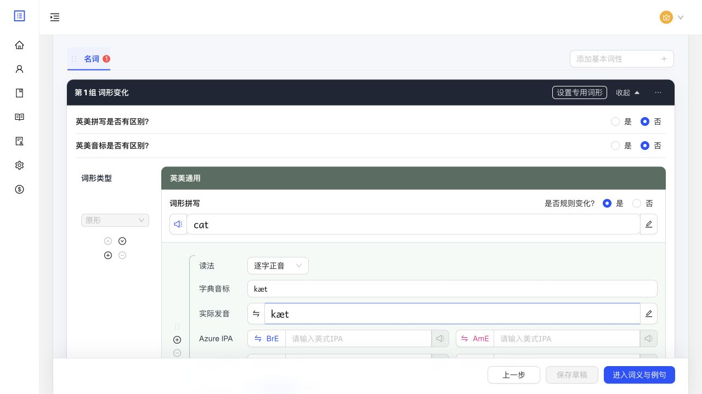

# 禅道 #133：读法

来源：[任务 #133](http://47.121.142.19/zentao/index.php?m=task&f=view&taskID=133)。

## 范围与验收

- “词形与发音”字段显示“读法”；选项按“语流连读 → 逐字正音 → 强读 → 弱读”排列。
- 既有 `normal` 值显示为“语流连读”；新增 `citation` 表示“逐字正音”，不改写旧数据。
- 编辑、草稿校验、方言拆合、保存、独立读回和预览保留新取值。
- 本次只扩展分类；音标转换对 `citation` 不套用既有语流/强弱读例词替换，沿用未定义规则提示。

## 依赖与实现

复用现有 V3 编辑、保存与预览流程。新增工作为读法枚举及数据库 CHECK 约束扩展，前端同步类型、runtime schema、选项与提示文案。

- 前端：`/Users/darwish/.codex/worktrees/2056/tsz`，基于 `5e7d3a45`。
- 后端：`/Users/darwish/.codex/worktrees/task-133-reading/tsz-rust`，基于 `0e4b9ad`。
- 两仓分支：`codex/task-133-pronunciation-style`；生成物来源为后端 SHA 加本任务工作区差异。
- 原生 OpenAPI 导出后同步，spec SHA-256：`b9bc860deb686cf62c7966a78acbc039e8fd5cd145a5bb86c744b54a82623af9`。
- 不新增端点；V3 词形保存、词条详情与相关快照中的 `PronunciationStyle` 新增 `citation`。
- 迁移：`20261016010000_add_citation_pronunciation_style`；未改动编译期校验 SQL，无需更新 `.sqlx`。

## 兼容与回退

- 新前端仍可读取旧三值数据，但提交 `citation` 至旧后端会被拒绝。
- 新后端仍支持旧三值；旧前端严格 runtime validator 无法读取包含 `citation` 的词条。
- 发布时须在开放新读法录入之前完成前后端切换，并处理仍打开的旧前端页面；不能让新读法数据进入旧客户端。
- down 迁移不转换/删除数据，存在 `citation` 存储行、草稿或发布历史 JSON 时均拒绝回退，须先安全处置这些数据。

## 验证

- 前端：读法下拉顺序与 `citation` wire 值、草稿结构校验、方言拆合、预览、错误提示、运行时枚举拒绝未知值。
- 后端：真实隔离 PostgreSQL/Redis 中保存四种读法并独立 GET 和 SQL 核对；迁移 up/down 及有新值时拒绝回退。
- 页面真实联调与最终质量门结果在当前任务对话中记录；本次授权终点为前后端分别提交、推送并创建配套 PR；合并和部署不在本次范围内。

## 已完成的真实联调

本地 Vite `127.0.0.1:13001` → 代理 `/api/v1` → 本任务构建的 Rust `127.0.0.1:18383` → 专用 PostgreSQL `127.0.0.1:15433/task133_browser` 与 Redis `127.0.0.1:16379/1`。V3 读写开关启用，目标 API 未使用前端 mock 或请求拦截；短信验证码使用后端既有 Mock sender。

临时词条 `01a142e7-9e36-7710-a791-a8f93d3c63d2`：从页面选择“逐字正音”、填写音标、保存，实际 PUT 返回 200；刷新后的独立 GET 返回 200，页面仍显示“逐字正音”，SQL 确认 style 为 `citation`，音标保持 `kæt`。

前端最终检查：全仓 typecheck、lint 通过（3 条既有 lint warning）；263 个测试文件通过，3,847 项通过、2 项既有跳过。后端最终验证：

- `cargo fmt --all --check` 通过。
- `SQLX_OFFLINE=true cargo clippy --locked --all-targets --all-features -- -D warnings` 通过；回退测试收尾调整后，对 lib 与 lexicon_handler 的增量 clippy 通过。
- 隔离连接下 `cargo test --locked --all-features --lib` 的 343 项通过；12 项迁移失败因最新版本基准未更新，修复后定向重跑迁移组 14 项全部通过（其中 2 项与原通过项重叠）。首次未传数据库/Redis 的环境失败已纠正。
- `cargo test --locked --all-features --test lexicon_handler v3_reading_styles_persist_and_round_trip_independently` 通过，覆盖四值独立持久化/GET、存储行/草稿/发布历史的新值回退保护及无新值时 down/up。
- api-client 单独 24 个文件、542 项契约与请求测试通过；生成 spec 哈希与 runtime bundle 一致。

清理回执：临时账号已退出；浏览器标签已关闭；专用数据库、PostgreSQL 数据目录与 Redis 实例已销毁；本任务 Rust/Vite 进程已停止，13001/18383/15433/16379 无监听。只保留源码、脱敏记录与截图；无 tshb-test 或正常业务数据变更。
