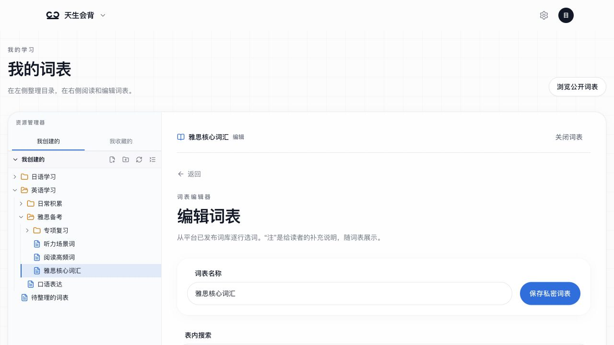
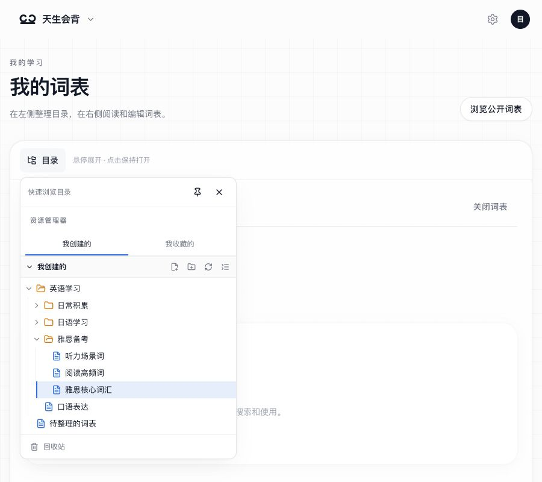

# 双目录技术设计

## 基线与依赖

前端基线 `cd8e1e01`，后端基线 `bd9010b`，两仓任务分支均为 `codex/wordlist-folders`。前端 checkout 为本目录所属仓库；后端为 `/Users/darwish/.codex/worktrees/0abd/tsz-rust`。本目录是唯一需求/设计主记录。

| 能力                             | 分类                   | 实施方式                                                   |
| -------------------------------- | ---------------------- | ---------------------------------------------------------- |
| 词表创建/编辑/发布审核           | 已在主线、复用         | 原 DTO 保持兼容，创建增加可选目标目录                      |
| 收藏引用/互动统计                | 已在最新后端主线、复用 | 原收藏入口接入目录事务与回收站                             |
| 软删除/公开权限/学习来源可用性   | 已在主线、复用         | 复用 `wordlists.deleted_at` 和来源代际；不改变历史学习记录 |
| 双目录、批量移动、删除批次、恢复 | 新工作                 | 新增个人目录节点表和服务                                   |
| C 端管理器                       | 新工作                 | 复用页面、按钮、弹窗、Query 与鉴权内核                     |
| 真实浏览器联调                   | 待准备                 | 隔离数据库/Redis，生产构建，核实代理和禁用 mock            |

关键路径：迁移与事务 → 后端 API/风险测试 → OpenAPI 与客户端 → 管理器及创建/收藏入口 → 真实持久化验证。预计 2–3 小时，以实际验证结果更新，不以估计代替完成。

## 数据模型与一致性

新增 `wordlist_library_nodes`：`id`、`user_id`、`space`（`owned`/`favorites`）、`parent_id`、`wordlist_id`、`name`（文件夹名称或收藏备注名）、`trashed_at`、`trash_root_id`、`revision`。`wordlist_id IS NULL` 表示文件夹；根目录为虚拟节点，`parent_id=NULL`。

同用户/系统/词表唯一；父节点复合外键保证用户和系统一致。活动同级文件夹名称唯一。目录写入按用户事务 advisory lock 串行化，先锁账户，再目录，再词表；批量操作在一个事务内完成，失败全部回滚。所有节点按 ID 排序后对字段和 revision 计算 SHA-256，作为整套目录的 `version`；写入携带 `expected_version`，拒绝过期的移动、重命名、删除、恢复和永久删除请求。原词表编辑器改名也增加目录节点 revision，避免两个入口覆盖彼此。服务层拒绝文件父节点、循环和超过 20 层的结果。

迁移将未删除的自建词表、已有收藏映射到根目录。新建词表在原创建事务内登记节点；收藏设置在原互动事务内登记/恢复节点，取消收藏进入回收站。目录删除移除活动收藏关系但保留目录节点；恢复重新建立收藏关系，不要求原词表当前公开。公开统计只统计活动收藏。

每次删除按顶层节点标记 `trash_root_id`，递归仅包含活动后代。单项恢复/永久删除只作用于该节点同批次后代，不能吸收更早单独删除的项目。删除祖先节点时，其他批次的直接子项目保留并改为根位置。恢复默认保留有效原父目录，否则使用根目录；可显式指定目标。恢复文件夹按实际目标逐一解决重名。

自建词表删除在同事务设置 `deleted_at`、`state='draft'`，增加 revision，取消待审；推荐与学习公开代际沿用现有数据库触发器。恢复只清除本任务软删除标记，后台已删除的词表不得被目录操作重新开放。永久删除移除词表条目和个人目录节点，保留软删除墓碑与必要历史引用，清除不再需要的个人内容；其他人的收藏节点继续显示不可用。

## 接口与兼容

新增 `/api/v1/me/wordlist-library/{space}` 下的列表、文件夹创建、重命名、批量操作接口。列表接受当前目录、回收站和搜索条件，返回目录面包屑、项目及分页；搜索返回位置路径。返回词表元数据沿用 `Wordlist`，不可用收藏的元数据为 null。

批量操作携带目录 `expected_version`、节点 ID、动作（move/trash/restore/purge）及目标目录。先提供删除影响预览，确认提交使用同一版本条件；子树有变化时拒绝旧确认。清空回收站针对当前系统，必须显式确认并由服务端执行全量清理，不能只删除浏览器当前页。

新增响应定义独立严格 schema；不向旧 `Wordlist` 响应追加字段。创建词表与收藏请求可增加可选 `folder_id`，旧请求默认根目录。新前端依赖新 API，不能回退为 localStorage 假持久化。发布时先后端后前端；旧前端仍能使用平铺列表，取消收藏也进入回收站。回滚迁移会丢失目录/回收站结构，必须先恢复或导出需保留的数据；不自动重新公开词表。

## 前端

`WordListBrowser` 的个人入口接入独立管理器，公共发现页保持原能力。使用按用户、space、目录、回收站和搜索隔离的 Query key；切换用户不复用目录状态。所有写入成功后失效相关个人列表/目录/互动及公开查询。异步写入核对当前账户，失败保留可重试状态。

导航记录目录与系统位置；选择、多选、移动目标选择、删除影响确认与恢复使用统一节点模型。移动目标只允许本系统活动文件夹，拖拽复用批量移动逻辑。收藏名称由备注名优先展示，原作者信息仅在原词表可读时返回。

## 验证与当前状态

- 先做隔离数据库迁移 up/down 和真实 handler 测试：权限、唯一约束、循环、并发、删除批次、恢复重名、收藏/公开边界。
- 生成后端 OpenAPI，显式 `OPENAPI_SOURCE` 同步前端快照，验证严格响应、请求路径和类型。
- 前端组件验证两套系统切换、批量操作、失败及创建/收藏目标。最终运行受影响测试、类型、lint 与后端 fmt/clippy。
- 真实后端 + `pnpm build`/`next start` 验证目录刷新、恢复和重新读取；无环境时准确记录未验证项。

当前阶段：实施和桌面验收完成，用户已授权两仓审查、提交、推送与 PR；正在完成独立精确提交审查和原生 hooks。合并与部署未授权。

## 工作区布局补充

主页面组合左侧 `LibraryTree` 与右侧目录管理/阅读/编辑面板。目录树按展开层级延迟请求并分页，沿用后端目录 API 和用户隔离的 Query key；不要为了树形展示一次下载所有词表内容。选中词表、模式及当前目录由 URL 保存，刷新后恢复视图；旧个人详情/编辑、新建入口转到工作区。`WordListDetail`、`WordListCreator` 增加嵌入模式复用原逻辑，切换按钮标记已有离页保护，不复制词表编辑器。

## 验证记录（2026-10-16）

- 前端：全仓 `pnpm test` 在目录首版通过 265 个文件、3863 个测试（2 个既有跳过）；工作区布局调整后受影响词表/契约测试通过，后续拖拽与编辑保护定向回归通过。`pnpm typecheck`、`pnpm lint`、生产 `pnpm build` 通过；lint 仅保留鉴权代码中两个既有整页跳转警告。
- 契约：`pnpm --filter @tsz/api-client test` 通过 548 项；OpenAPI 来自本任务后端 checkout，runtime bundle 哈希与原始 spec 一致。新增响应采用独立 schema，原 `Wordlist` 响应没有扩字段；新请求的 `folder_id` 可选。
- 后端：`wordlists_handler` 24 项、`wordlists_review` 12 项、`wordlists_schema` 1 项、`wordlists_tips` 4 项通过；迁移 up/down 已在 sqlx 独立测试数据库验证。`cargo fmt --all --check` 与 `SQLX_OFFLINE=true cargo clippy --locked --all-features --all-targets -- -D warnings` 通过。新增用例在既有 handler target 内，继续由原 CI 分区执行；动态参数化 SQL 未新增离线宏缓存。
- 真实链路：任务专用 Postgres `127.0.0.1:55436`、Redis `127.0.0.1:56386`，后端 `127.0.0.1:58386`，Next 生产构建 `127.0.0.1:53086`，代理 `/api/v1` 指向该后端。使用两个专用虚构用户、两份词表和一个词条；未连接 tshb-test。
- Codex 内置浏览器已验证：登录、两套系统独立同名目录、词表移动后刷新、右侧阅读/编辑保存及刷新持久化、整树删除影响预览、整树恢复、收藏时选择文件夹、重复收藏定位、未保存切换提示、目录树拖动到根目录、右侧列表拖入左侧文件夹（最终无调试日志构建复验通过）。永久清空的真实数据行为由 handler 测试验证；没有在浏览器里清空其他数据。
- 暂未覆盖：真实手机设备和大量目录的性能压测。现有测试不替代这两项验证。

工作区预览：

## 清理与交付状态

2026-10-16 已退出内置浏览器测试账号、关闭临时标签页，停止本任务 Next/后端/Postgres/Redis 和外部初始浏览器进程。专用 Postgres 数据目录（包含失败测试残留库）、Redis 临时数据、测试凭据及原始浏览器快照已移除；四个测试端口均无监听。保留代码、构建缓存、测试日志及上述虚构数据的脱敏预览图。未触及共享环境、正常业务数据或 tshb-test。

两仓分支为 `codex/wordlist-folders`，均为基线 SHA 加本次工作区差异，尚无本任务提交或 PR；CI、合并与部署未执行。后续若发布，应先交付后端迁移/API，再交付前端工作区，并按配套发布规则复核精确提交。真实手机和大量目录性能验证仍未运行。

## VS Code 风格资源管理器增量验收

2026-10-16：仅调整前端资源管理器与现有操作接线，未修改后端接口。目录组件 8 项测试通过，覆盖右键子目录创建目标、键盘展开、全部折叠、分隔线宽度、拖拽及原有删除/恢复；web typecheck、lint、生产构建通过，lint 保留两个既有鉴权跳转警告。

Codex 内置浏览器连接独立真实后端验证了多级展开、右键菜单、新建子文件夹的准确归属、全部折叠保留右侧内容、鼠标拖动目录宽度从 260px 到 320px、选中词表后进入右侧编辑器。预览图已更新。本轮专用虚构用户、8 份词表、目录与词条所在独立数据库及 Redis、凭据、临时 fixture 源码和进程均已清理，四个端口已复查关闭；未提交或部署。

## 响应式目录增量验收

2026-10-16：新增 `ResponsiveExplorer`，通过 `matchMedia`/`useSyncExternalStore` 选择侧栏、非模态 hover 浮层或模态抽屉。目录节点始终保持挂载；只记录用户滚动，避免浏览器因容器高度变化自动归零时覆盖记忆值。浮层跟随触发按钮定位；菜单 Portal 标记用于延迟关闭与 Esc 分层处理。抽屉恢复背景 inert、页面滚动和返回焦点。移除工作区外层 transform，以免固定浮层/遮罩被局部容器坐标限制。

Codex 内置浏览器 + 真实隔离后端验证：

- 900×800 鼠标：仅悬停展开、点击保持打开、移入右键菜单、首次 Esc 关闭菜单而保留浮层、第二次 Esc 关闭浮层。
- 390×844 触摸模拟：点击打开抽屉、背景遮罩与焦点隔离、逐级展开文件夹保持打开、选中词表后自动关闭并返回触发按钮焦点。
- 390 → 1200 → 900px：右侧未保存标题保留，目录展开状态保留。
- 900×600 → 1200×800 → 900×600：真实滚动偏移从 135.5px 恢复为 135.5px。
- 词表相关 61 项回归通过；滚动恢复修复后相关 12 项定向重跑通过。web typecheck、lint、生产构建通过（仅两个既有鉴权跳转警告）。触摸模拟不等同于真实手机硬件验收。

测试结束已退出账号、关闭临时标签，恢复内置浏览器默认视口并关闭触摸模拟；本轮隔离数据库、Redis、凭据和测试进程已清理，四个端口复核关闭。未提交或部署。

| 鼠标 hover 浮层                  | 触摸抽屉                        |
| -------------------------------- | ------------------------------- |
|  |  |

## 交付基线

交付前已接入最新主线：前端 `02cfe814a19e19d81f4c20de4720cfc8dd942ea2`，后端 `ab6cd93df503891e3128a60a097551bcc5c72f0e`。OpenAPI 从更新后的本任务后端重新导出，不覆盖主线的发音配置能力。以下实施阶段的「未提交」描述为当时记录；最终提交、PR 与 CI 状态以交付对话和关联 PR 为准。

## 提交前审查与兼容边界

交付自检和独立审查补充了以下回归：等待锁期间注销期限到达必须回滚；活动祖先移到最大合法深度后，回收站按删除批次展示而不误用活动目录深度限制；从子目录打开根目录词表不能沿用旧目录位置；阅读/编辑视图中左树拖拽失败也必须显示错误。工作区登录和绑定手机的回跳保留查询参数，CI 冒烟已改为验证工作区创建与刷新链路。

候选组合的契约检查和已有真实链路有效：旧前端请求字段可继续由候选后端处理，`Wordlist` 响应形状不变；新前端依赖新增目录端点，不能先于后端发布。实际已部署版本尚未在本次交付中核实，执行部署时仍须复核配套发布门禁。旧后端二进制不维护目录节点，回退后若继续创建/收藏会造成目录记录缺失，不能视为可无缝写入并再次升级的组合；需停写并保留新 schema、对账后再恢复。down 迁移会丢失目录与回收站组织信息，不能作为普通发布失败时的无损回退。
